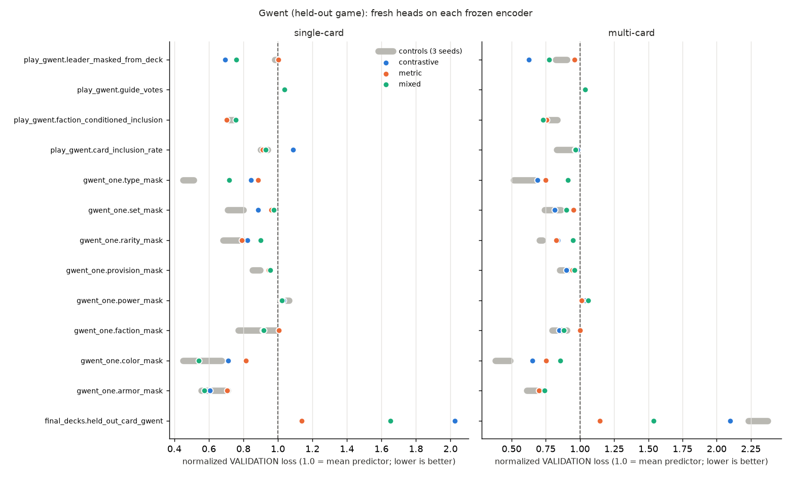
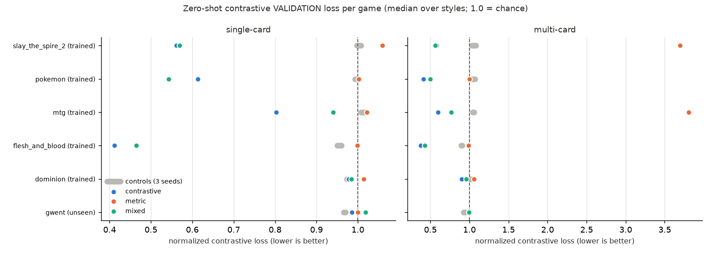

# Series 1, round 2: model × diet on a stable embedding

**Status:** concluded
**Dates:** 2026-10-11 - 2026-10-14
**Parent:** [2026-10-09_model_by_diet](../2026-10-09_model_by_diet/NOTEBOOK.md) · **Branch:** `experiment/2026-10-11_model_by_diet_r2`

> Now that the embedding is stable (output LayerNorm, token whitening,
> mean pooling), which model (single-card or multi-card) and which diet
> (contrastive, metric or 50/50) trains the most useful general card
> embedding, and does any of them beat the untrained whitened encoder?

## Aim

**Problem (priority: the fix).** Pick the default model and diet for
series 2 and 3.
- **Metric:** the per-card probe from
  [2026-10-10_pooling_probe](../2026-10-10_pooling_probe/NOTEBOOK.md), on
  the "isolated" view (each card alone through the whole model):
  - same-deck AUC (0.5 = chance);
  - linear-classification balanced accuracy over card fields.
- **Current value:** not measured on this setup. The nearest is the
  pooling pilot's `tokwhite_mean`: deck AUC 0.680 and linear-cls 0.672,
  after 3,000 steps on a reduced diet. The unwhitened untrained model
  scores 0.539 and 0.770
  ([pilot probe CSV](../2026-10-10_pooling_pilot/results/probe_checkpoints.csv)).
- **Bar:** the best cell beats its own untrained whitened-mean control by
  at least **+0.03 deck AUC**, and loses no more than **0.03 linear-cls
  balanced accuracy** against that control. The bar must hold twice:
  - on the full probe, which is comparable with the pilot;
  - on the out-of-sample slice: Gwent's deck AUC, and linear-cls on
    non-TRAIN-tier cards over fields no dojo trained.

  If it holds on the full probe but not on the slice, it is reported as
  "met in sample only".
- **Ranking and choosing:**
  - Cells that pass the linear-cls limit are ranked by deck AUC.
  - Cells within 0.02 of the top cell count as tied. Among tied cells,
    mixed beats the single-objective diets, and then single-card beats
    multi-card (it is cheaper and simpler).
  - If no cell meets the bar, the default stays the untrained whitened
    encoder plus whichever cell loses the least linear-cls. The next
    experiment then targets the information loss.
  - One seed makes this a pilot-strength choice
    (`EXPERIMENT_PRINCIPLES.md` §1).

Training can cost per-card information. In the pilot, training lowered
linear-cls from 0.77 (untrained) to 0.67 while deck AUC rose. That is
why the bar compares against an untrained control and covers both
measures.

**Hypotheses** (second priority, understanding):
- **H1, diet.** The 50/50 mixed diet gives the best balance:
  - contrastive-only wins deck AUC but loses field probes, as in the
    shakeout's collapse
    ([2026-09-30_first_train_shakeout](../2026-09-30_first_train_shakeout/NOTEBOOK.md));
  - metric-only keeps the field probes but gains little deck AUC.

  *Refuted if* either single-objective diet matches or beats mixed on
  both deck AUC and linear-cls, within the same model. It is judged
  separately for each model. If it holds for one model and not the
  other, the verdict is "model-dependent".
- **H2, model.** On per-card probes there is no clear difference between
  single-card and multi-card. Group attention should help a card in
  context, not the card alone. *Refuted if* either model leads the other
  by 0.02 or more deck AUC on the same diet, in either direction.

## Background

Series 1 asked this same question on 2026-10-09 but never answered it.
Its only cell, `multi_mixed`, showed that the setup itself was unstable.
Three follow-ups fixed that:
- **[lr_pilot](../2026-10-10_lr_pilot/NOTEBOOK.md):**
  - an output LayerNorm (no gain or bias) ended the metric blowups;
  - `encoder_lr` 1e-4 kept the most card-specific spread;
  - contrastive stayed at chance.
- **[pooling_probe](../2026-10-10_pooling_probe/NOTEBOOK.md):** frozen
  ModernBERT features are anisotropic. Whitening raises the fixed-feature
  deck AUC from 0.54 to about 0.65; centering alone barely helps.
- **[pooling_pilot](../2026-10-10_pooling_pilot/NOTEBOOK.md):**
  - token whitening moves contrastive off chance (0.81-0.86, against
    1.00 without it);
  - trainable pooling adds little over whitened mean pooling;
  - whitening loses numeric field detail (R² 0.27-0.34, against 0.57
    for unwhitened 4-query attention).

This round reruns the series-1 design with those fixes, and with fewer
and longer rounds. In series 1, TEST took 38% of each 1,000-step round.

## Method

- **Terms:**
  - a *cell* is one model × diet combination;
  - a *control* is an untrained model of the same shape;
  - a *batch* is one queued run of the lab technician (here, one cell).
- **Cells** (configs in [`configs/`](configs/); they differ only in
  `model` and the diet):

  | | contrastive only | metric only | 50/50 mixed |
  |---|---|---|---|
  | **single-card** | `single_contrastive` | `single_metric` | `single_mixed` |
  | **multi-card** | `multi_contrastive` | `multi_metric` | `multi_mixed` |

  - trained dojos: 25 contrastive (5 styles × 5 games), 124 metric, or
    149 for mixed; plus the same 13 held-out dojos in every cell
    (counted by parsing the configs against today's catalog);
  - diets as in series 1: contrastive styles weighted equally, then
    games equally; metric dojos weighted by TRAIN count ** 0.3; mixed is
    half and half.
- **Controls:** untrained single-card and multi-card models, built after
  the training runs and probed the same way:
  - each is built by `build_model` from `configs/single_mixed.yaml` or
    `configs/multi_mixed.yaml` under seed 0;
  - its weights are saved as `latest/encoder.pt`, next to a copy of the
    config, in `data/runs/2026-10-11_model_by_diet_r2/control_<model>/`;
  - it should then match the trained cells' starting weights. Building
    them includes checking that the RNG order reproduces the round-0
    initial weights.

  A second, head-free reference is the whitened mean-pooled ModernBERT
  feature alone. Offline it scored 0.613-0.637 deck AUC
  ([pooling_probe](../2026-10-10_pooling_probe/NOTEBOOK.md)).
- **Probe split** (decided before results, from the design review):
  - The probe's cards and decks are not filtered by holdout tier.
    Contrastive dojos train on decks from 5 games, and metric dojos
    train some probe fields directly (MTG, Hearthstone and Dominion
    type, Spire rarity). So the full probe is partly in-sample, and in
    a different way for each diet.
  - The probe is therefore also reported split by card tier (TRAIN
    against VALIDATION/TEST under holdout seed 0), with its fields split
    into trained ones and held-out ones (class, pitch, STS2 type).
  - Gwent's deck AUC is the clean deck number.
  - Output goes to this experiment's `results/`, labelled
    `r2_<cell>` / `r2_control_<model>`. It does not go to the pooling
    probe's shared CSV.
- **Held constant:**
  - **model:** frozen ModernBERT-base; token whitening
    (`data/whitening/modernbert_tokens_holdout_seed0.pt`); mean pooling;
    `residual_mlp` head, 256-wide embeddings, `mlp_hidden_dim` 512;
    output LayerNorm (in the code since the lr_pilot);
  - **architectures:** single-card has 9 MLP blocks. Multi-card has 3
    blocks plus 2 pre-norm group-attention layers (4 heads, FFN 1024,
    dropout 0.1);
  - **optimizer:** `encoder_lr` 1e-4, `head_lr` 1e-3. The config's
    "encoder" (`encoder_trainable: true`) is the card model's trainable
    part: pooling, embedding head and group attention, about 2.9M
    parameters. ModernBERT stays frozen;
  - **budget:** 4 rounds × 5,000 steps = 20,000 steps. Saturation is off
    (`patience_rounds` 1000), so the diet never changes;
  - **data:** training seed 0; holdout seed 0, tiers 8/1/1, Gwent held
    out (every Gwent card is VALIDATION-tier, and no Gwent dojo is
    trained);
  - **batches:** Huber regression loss; `max_batch_cost` 256; fp16;
    128 TEST examples per dojo per round.
- **Metrics:**
  - **Primary, after training:** the probe on each cell's final
    checkpoint and on each control (deck AUC, linear-cls bacc, linear
    R², kNN). The pipeline view is reported too.
  - **Secondary:**
    - median normalized TEST loss per round, split into contrastive,
      metric and held out (1.00 = chance for contrastive; 1.0 = mean
      predictor for metric);
    - Gwent's per-game deck AUC, since Gwent is the unseen game.
  - **Later, outside this aim:** the evaluation tools
    (`scripts/run_evaluation.py`, intrinsic analyses and extrinsic
    fresh-head runs on the held-out dojos), on the checkpoints this
    experiment keeps.
- **Predictions** (written before launch):
  - the bar above, and H1 and H2 as stated in Aim;
  - contrastive TEST leaves chance in the contrastive and mixed cells
    (pilot: 0.81-0.86 after 3,000 steps). Staying at or above 0.95
    after 20,000 steps would mean the pilot's result does not carry over
    to the full diet;
  - no trained metric dojo goes above 5× in any round (lr_pilot: 0).
- **Noise:** one seed. A gap under 0.02 deck AUC, or under 0.02
  linear-cls, is reported as "no clear difference". For scale, the
  pilot's whitened variants spread over 0.655-0.697 deck AUC.
- **Known confounds:**
  - Trainable parameter counts differ slightly: about 2.9M for each
    model in series 1. Whitening and mean pooling add no trainable
    parameters. `--check` reports the exact counts.
  - TEST covers only a cell's own dojos plus the 13 held-out ones. That
    is 38 for contrastive-only, 137 for metric-only and 162 for mixed.
    So only the held-out dojos' TEST numbers compare across all six
    cells, and the cells' run times differ while their step budgets
    stay equal.
  - The probe is partly in-sample, and in a different way for each diet
    (see Probe split).
  - The whitening stats were fitted on TRAIN-tier cards of this
    holdout. The probe's cards may overlap them; the parent probe
    judged the optimism small but did not measure it.
- **Cost** (from `experiments/README.md`; full mixed diet, multi-card):
  - startup about 28 min;
  - about 117 min of training per 5,000-step round (about 1.4 s per
    step), plus about 14 min of TEST;
  - so about **9 h per mixed or metric cell**, and somewhat less for
    contrastive-only. About 50-55 h in total, run as six batches of one
    cell each (human decision 2026-10-11). Single-card step time is not
    measured yet.
  - Disk: about 2.4 GB per run, so about 15 GB in total. The probe and
    controls take minutes each.

## Recipe

- **Data:** every metric parquet and split the catalog keys need.
  `PYTHONPATH=. python scripts/run_training.py <config> --check` passes on
  `configs/single_mixed.yaml` (it holds every dojo any cell uses).
- **Whitening stats:**
  `data/whitening/modernbert_tokens_holdout_seed0.pt` (2026-10-10 16:43),
  from the pooling pilot:
  `PYTHONPATH=. python scripts/fit_whitening.py --holdout-from <any config here> --out data/whitening/modernbert_tokens_holdout_seed0.pt`.
- **Training** (ROCm venv `G:\Projects\venvs\tcg-rocm`), one cell per
  batch:
  `PYTHONPATH=. python scripts/run_training.py experiments/2026-10-11_model_by_diet_r2/configs/<cell>.yaml`.
  Outputs land in `data/runs/2026-10-11_model_by_diet_r2/<cell>/`.
- **Probe:** `analysis/probe_cells.py` wraps
  `experiments/2026-10-10_pooling_probe/analysis/probe_checkpoint.py`
  with the tier and field split (see Probe split). Step 2 below.
- **Evaluation, as run** (added 2026-10-14). Run each from the repo root
  with `PYTHONPATH=.`, in the ROCm venv. Paths below are under
  `experiments/2026-10-11_model_by_diet_r2/`. Each one writes to `results/`, or
  to the ignored `data/evaluations/2026-10-11_model_by_diet_r2/`.
  1. `analysis/test_loss.py` and `analysis/resources.py`: TEST tables and
     the resources table, from the runs' console logs and samples.
  2. `analysis/probe_cells.py`, then `analysis/probe_report.py`: the
     probe, the bar table and its figures. Minutes.
  3. `analysis/extrinsic_held_out.py`, then `analysis/extrinsic_report.py`:
     fresh heads on the 13 held-out dojos. About 4-9 min per encoder.
  4. `analysis/intrinsic_suite.py`, then `analysis/intrinsic_report.py`:
     the `src/evaluation` intrinsic suite. About 30 min.
  5. `analysis/extrinsic_gwent.py`, then `analysis/gwent_report.py`: fresh
     heads on the Gwent dojos.
  6. `analysis/zero_shot_contrastive.py`: about 8-10 min per encoder.
- **Environment:** AMD RX 6800 (16 GB), torch 2.10.0+rocm7.13 (bench
  notes). Each run's whitening stats are a per-run `whitening_stats.pt`
  copy of the Method's file. All six are byte-identical (step 2 Log
  entry).
- **Trainable parameters** (from the runs' logs and config checks, in
  the bench notes): single-card 2,898,176; multi-card 2,895,616.
- **TEST table:**
  [`../2026-10-10_lr_pilot/analysis/compare.py`](../2026-10-10_lr_pilot/analysis/compare.py)
  on each cell's console log.
- **Configs:** the six files in `configs/` were launch configs, generated
  from series 1's launch configs (patterns kept). Each was replaced by its
  run's recorded `run_config.yaml` once it ran, so they now point to the
  per-run `whitening_stats.pt` copies.
- **Data sizes are not recorded here** (decks per contrastive game, TRAIN
  examples per dojo, cards per game). This is a known gap; see the
  Corrections entry on `diet_shares.csv`.

## Log

### 2026-10-11 · Design decisions

What:
- whitening + mean pooling + `encoder_lr` 1e-4 in every cell;
- 4 × 5,000 steps instead of 20 × 1,000;
- one cell per batch;
- final checkpoints kept for the probe and for later evaluation;
- controls built at the end.

Why:
- the three follow-ups above settled the model block;
- the human chose not to re-check `encoder_lr` 3e-4 (the lr_pilot's
  "re-check once the offset is removed"), and not to pilot the
  single-card model separately, since both cost hours and would not
  change the design;
- longer rounds cut the TEST share from about 38% to about 11%.

Seen: the configs parse against today's catalog with the same dojo
counts as series 1.

### 2026-10-11 · Design review (experiment-critic) and changes

What: one design-mode pass found no blocker to launch. Its concerns,
and the response to each:
1. **The probe is partly in-sample, unequally by diet.** Added the
   probe split, and a second, out-of-sample reading of the bar.
2. **The control had no recipe.** Defined it (`build_model`, seed 0,
   same starting weights), and added the head-free whitened feature as
   a second reference.
3. **No rule for picking a cell.** Added the ranking, the tie-break and
   the fallback if no cell meets the bar.
4. **H2 could be refuted in one direction only, and H1 had no
   per-model verdict.** Both fixed.
5. **The TEST confound was misstated.** Each cell scores only its own
   dojos plus the held-out ones; corrected.
6. **Probe output went to the shared pooling-probe CSV.** It now goes
   to this experiment's `results/`, labelled `r2_*`.
7. **Provenance.** The experiment folder is committed on its branch
   before launch, and the frozen-ModernBERT wording is clarified.

Why: every change is to how the results will be read, so it is fixed
now, before any result is seen. No config changed.

### 2026-10-12 · Batch 1 (lab_technician)

- [multi_mixed done](bench_notes/2026-10-12_0635_multi_mixed_done.md): exit 0, 518 min; TEST medians after round 3: contrastive 0.662 (1.00 = chance), trained metric 0.942, held out 1.083 (1.0 = mean predictor).
- [Batch 1 wrap-up](bench_notes/2026-10-12_0640_batch1_wrap_up.md): no incidents; results in `results/test_loss_by_round.*`.

### 2026-10-12 · Batch 2 queued (human decision)

What: batch 2 runs the two remaining multi-card cells back to back:
`multi_contrastive`, then `multi_metric`. They are estimated at about
8 h and 8.7 h, so about 17 h in total, under the ~24 h gate.

Why: the human reviewed batch 1 and read it as "the training is
working". Running the other multi-card diets next completes the
multi-card row of the grid.

### 2026-10-12 · Batch 2, run 1 (lab_technician)

- [Incident: launcher re-ran training](bench_notes/2026-10-12_1500_incident_launcher_rerun.md): small issue 1 of 5. An edit to the launcher mid-run lost `multi_contrastive`'s console capture and resource samples. Training data intact; no confound.
- [multi_contrastive done](bench_notes/2026-10-12_1505_multi_contrastive_done.md): 399 min; TEST medians after round 3: contrastive 0.532 (1.00 = chance), held out 1.134 (1.0 = mean predictor).

### 2026-10-12 · Batch 2 extended (human decision)

What: `single_contrastive` and `single_metric` were added to batch 2,
after `multi_metric`. Projected end: about 15:00 on 2026-10-13, so about
17 h from the decision (21:47) and about 31 h for batch 2 as a whole
(from 08:18 on 2026-10-12), past the ~24 h gate. The human asked for this
explicitly, and that is the approval.

The estimates reuse the multi-card figures: single-card step time has
not been measured. No separate `--check` is run for these two, so that
check jobs don't overlap `multi_metric`'s resource samples. Each run's
own startup preflight serves as the check, and a failure there is
handled as a small issue.

### 2026-10-12 · Batch 2, run 2 (lab_technician)

- [multi_metric done](bench_notes/2026-10-12_2335_multi_metric_done.md): exit 0, 511 min; TEST medians after round 3: trained metric 0.936, held out 1.111 (1.0 = mean predictor). The first fully sampled run: VRAM 3.6 GB of 16, GPU compute busy 76% (median), Python CPU about 2.8 of 16 threads.

### 2026-10-13 · Batch 2, run 3 (lab_technician)

- [single_contrastive done](bench_notes/2026-10-13_0555_single_contrastive_done.md): exit 0, 380 min; TEST medians after round 3: contrastive 0.670 (best in round 2, 0.647; 1.00 = chance), held out 1.153 (1.0 = mean predictor). GPU compute busy 57% (median).

### 2026-10-13 · Batch 2, run 4 and wrap-up (lab_technician)

- [single_metric done](bench_notes/2026-10-13_1410_single_metric_done.md): exit 0, 499 min; TEST medians after round 3: trained metric 0.997, held out 1.132 (1.0 = mean predictor).
- [Batch 2 wrap-up](bench_notes/2026-10-13_1415_batch2_wrap_up.md): 5 of 6 cells done; `single_mixed` held by the human. On TEST, multi-card beats single-card on the same diet, and no diet moves the held-out dojos. Resource and timing table in `results/resources_by_cell.csv`.

### 2026-10-13 · Batch 3 queued (human decision)

What: batch 3 is the last cell, `single_mixed`, estimated at about
500 min (26 min startup plus 4 rounds of about 118 min, from
`single_metric`), so well under the ~24 h gate. The human held it on
2026-10-13 after batch 2 and released it the same evening.

Pre-flight: free RAM 23.9 GB, VRAM 17.0 of 17.2 GB free with no other
Python process, 1.1 TB free on G:. No separate `--check`; as for the
other single-card cells, the run's startup preflight covers it. Its
launch config differs from `multi_mixed` only in the model block.

### 2026-10-14 · Batch 3, run 1 and wrap-up (lab_technician)

- [single_mixed done](bench_notes/2026-10-14_0730_single_mixed_done.md): exit 0, 478 min; TEST medians after round 3: contrastive 0.745 (1.00 = chance), trained metric 0.947, held out 1.093 (1.0 = mean predictor).
- [Batch 3 wrap-up](bench_notes/2026-10-14_0735_batch3_wrap_up.md): all 6 training cells done. On TEST, multi-card is lower than single-card on every diet (the mixed trained-metric gap is under 0.02); mixed matches or beats metric-only on trained metric; no cell moves the held-out dojos below 1.08. The probe and controls are next (principal investigator).

### 2026-10-14 · Step 2: probe, controls and fresh-head runs (principal investigator)

What: the human asked for step 2 (evaluate every trained model) and then
a review of all findings. Three pieces, all from `analysis/`:
1. **Per-card probe** (`analysis/probe_cells.py`): the pooling probe's
   card pool and metrics, plus the Method's probe split. Results in
   `results/probe_summary.csv`, `probe_by_field.csv` and
   `probe_deck_by_game.csv`.
2. **Probe tables and figures** (`analysis/probe_report.py`):
   `results/probe_vs_control.csv` (the bar, per cell) and four figures.
3. **Fresh-head runs on the 13 held-out dojos**
   (`analysis/extrinsic_held_out.py`, `src/evaluation/extrinsic`): each
   encoder frozen, the held-out dojos' heads trained from identical
   starting weights (6 rounds × 500 steps, uniform diet, head lr 1e-3,
   seed 0), then scored on VALIDATION at each head's best TEST round.
   Encoders: the six cells and one untrained control per model shape.
   Output: `results/extrinsic_validation.csv`.

Deviations from the Method, decided before the fresh-head results:
- **Controls cannot match the cells' starting weights.** Training never
  seeds the model's initial weights (`scripts/run_training.py` calls no
  `torch.manual_seed`; only the dojos and diet are seeded), so the
  Method's check "the RNG order reproduces the round-0 initial weights"
  cannot pass. Instead each model shape has three untrained controls
  (`torch.manual_seed` 0, 1, 2), which also shows how much a random
  initialization moves the probe. The bar is reported against control
  seed 0 and against the mean of the three.
- **The held-out TEST numbers in the bench notes do not measure transfer.**
  The trainer evaluates held-out dojos every round but never trains
  their heads (`src/training/README.md`: "evaluated every round but
  never trained on"), so their loss is that of a randomly initialized
  head. Flat values of 1.08-1.15 are expected whatever the encoder
  learned. The wrap-up observation "no diet moved the held-out dojos" is
  correct as a number but says nothing about the embedding
  ([batch 3 wrap-up](bench_notes/2026-10-14_0735_batch3_wrap_up.md),
  [batch 2 wrap-up](bench_notes/2026-10-13_1415_batch2_wrap_up.md)). The
  fresh-head runs replace it as the transfer measure. The Method listed
  them as "later, outside this aim"; they are run now at the human's
  request and reported as secondary evidence, not as part of the bar.
- **Speed: the frozen features are computed once per card.** ModernBERT,
  token whitening and mean pooling have no trainable weights, and all six
  runs used byte-identical whitening stats, so both scripts compute the
  pooled 768-d vector once per card and run only each model's head and
  attention. `probe_cells.py` checks this against the real model on 64
  cards per cell: minimum cosine 1.00000 in all six.
- **The out-of-sample linear-cls slice uses every card of the three
  games** (Hearthstone, Flesh and Blood, Slay the Spire 2), not just the
  probe pool, so that the non-TRAIN-tier subset is large enough: 1,272
  Hearthstone class, 860 pitch and 101 STS2 type cards, 5-fold CV.

Why: the probe is the Aim's decision metric; the fresh-head runs are the
only measure of transfer to dojos the encoder never trained on.

### 2026-10-14 · PI review, draft for discussion (principal investigator)

This is a draft. Nothing here is a Conclusion yet: the verdicts below are
proposed, for discussion with the human. Every number is in Results.

**Proposed verdicts** (judged against the predictions written before
launch):

| part of the aim | proposed verdict | evidence |
|---|---|---|
| Problem: the bar | **not met.** Every cell fails the linear-cls limit, and all cells are below their controls on the slice. Under the fallback rule, the default stays the untrained whitened encoder, plus the cell that loses the least linear-cls: `single_mixed` (-0.036 vs seed 0) and `single_contrastive` (-0.038) are tied (under 0.02). | `probe_vs_control.csv` |
| H1, diet | **model-dependent.** Single-card: refuted. Contrastive-only beats mixed on deck AUC (0.767 against 0.711), with no clear linear-cls difference (0.615 against 0.617). Multi-card: not refuted. Contrastive-only leads on deck AUC (+0.027) but loses linear-cls (-0.023), and metric-only is worse on both. The predicted mechanism was wrong: metric-only does not keep the field probes, it collapses the embedding. | `probe_summary.csv` |
| H2, model | **refuted**, in single-card's favour. On the contrastive diet single-card leads by 0.030 deck AUC, and the bootstrap intervals don't overlap. Mixed shows no clear difference (0.711 against 0.710). The metric-only gap (+0.022 to multi) is between two collapsed embeddings near chance, so it carries little weight. | `probe_summary.csv` |

**Key findings**

1. **TEST and the per-card probe disagree about the model.** Multi-card
   wins TEST on every diet, but single-card matches or beats it on the
   isolated per-card probe. Two observations point the same way:
   multi-card's TEST advantage lives in context, and running group
   attention over a group of one costs card information. The second
   shows in multi-card's pre-attention view, which keeps 0.05-0.08 more
   linear-cls than its isolated view.
2. **Metric training with a trainable encoder collapses the card
   embedding while its TEST loss improves.** Effective rank falls to 2.7
   and 5.6. A likely cause (a hypothesis, not tested):
   - the metric heads total about 17M parameters, against the encoder's
     2.9M, so they can decode tiny differences, and nothing pushes the
     encoder to keep its geometry spread out;
   - the metrics that learn best are run-level ones (e.g. STS2 character
     at 0.06), which a few directions solve.

   Falling metric TEST is therefore not evidence of a better embedding.
3. **Contrastive training is the only source of the deck signal.** The
   signal holds for non-TRAIN-tier cards in the seen games (0.725
   against about 0.57), but not for the unseen game: Gwent deck AUC is
   below the controls in every cell. It also helps a deck-level held-out
   task strongly (FaB hero from deck: 0.24-0.29 against 0.92-1.01).
4. **Every trained cell loses card-field information**, and most on the
   fields no dojo trains (slice: -0.09 to -0.20).
5. **The untrained head loses the most information of all.** The frozen
   whitened mean beats every trained cell and every control on
   linear-cls (0.863), the slice (0.956) and Gwent (0.639). The 256-d
   residual MLP head loses much of that before any training. This is
   the largest effect in the experiment, and the cheapest to study: an
   offline probe of untrained head variants needs no training.
6. **The mixed diet transfers best to held-out dojos with fresh heads**
   (median 0.856 single and 0.814 multi, against 0.938 and 0.915 for the
   controls; 7 of 13 dojos better than control). Contrastive-only and
   metric-only show no clear median difference from their controls.
   This is secondary, one head seed and a short head budget, and 4 of 13
   dojos don't learn at all.
7. **Small per-card statistic dojos overfit.** About 450 TRAIN cards
   each, sampled throughout 20,000 steps, leaves their TEST worse than
   the mean predictor (up to 2.4×).

**The human's questions**
- **Is multi-card the better model?** Not for per-card embeddings, on
  this evidence. It wins when cards are scored together, which is
  exactly where its attention helps. On the isolated view it is tied or
  worse, and it costs about 5% more time per step. If downstream use is
  per-card retrieval or storage (what evaluation stores), single-card is
  the pick for now. If downstream use is in-context (scoring a deck), it
  is multi-card. One seed; a second seed would firm this up.
- **Contrastive pre-training, then metrics as post-training?** Partly
  supported:
  - contrastive is clearly the right pre-training signal;
  - metric training on a trainable encoder is destructive, so metric
    "post-training" should leave the encoder frozen (heads only), or use
    a guarded fine-tune. Related work: Kumar et al. 2022, *Fine-Tuning
    can Distort Pretrained Features*
    ([arXiv:2202.10054](https://arxiv.org/abs/2202.10054)), whose
    linear-probe-then-fine-tune recipe fits this case.

  Against a pure curriculum: mixed transferred best to fresh heads. So
  some metric signal during pre-training may help, as long as the
  contrastive loss keeps the geometry from collapsing. That is a
  testable question (proposed experiment B).
- **More contrastive or more metric data?** The data says the bottleneck
  right now is the model, not the data:
  - the frozen features already hold most of the card-field information
    that training loses (finding 5);
  - metric TEST improvements did not make better embeddings (finding 2).

  Within that, what the data does suggest:
  - **Contrastive:** more decks for the small games (Pokémon has 150
    TRAIN decks, and its probe deck AUC of 0.93 is probably partly
    memorized). The Gwent result also says that deck signal does not yet
    cross games, so more game variety may matter more than more MTG
    decks.
  - **Metric:** prefer metrics with many examples per target (run-level,
    pick-level, draft-level). Per-card statistic dojos with a few
    hundred cards overfit as currently weighted, and need either
    pooling across games or far fewer steps.
  - Which metrics best preserve card fields can't be answered from this
    grid. It needs an ablation by metric family (proposed experiment C).
- **Faster training.** The frozen-feature cache works exactly (minimum
  cosine 1.00000 against the real model). With it, a fresh-head run
  covered 3,000 steps in about 4 min per encoder, once 51.5k cards were
  cached. While ModernBERT stays frozen, training could read cached
  features instead of running the language model every step. That is
  likely the biggest throughput gain available, ahead of batch-size
  tuning. Not measured for training yet.

**Weaknesses to discuss**
- One training seed, and one head seed for the fresh-head runs.
- The controls can't reproduce the cells' starting weights.
- The probe pool's decks are partly TRAIN decks: deck AUC is partly in
  sample, as the Method expected.
- The fresh-head budget is short.

**Proposed next experiments** (for discussion; not yet in
`experiments/TODO.md`):
- **A. Head that preserves the frozen features.** First, an offline
  probe of untrained variants (minutes, no training):
  - a linear projection;
  - a residual skip from the frozen feature;
  - 512 or 768 wide;
  - no output LayerNorm.

  Then a short training pilot with contrastive and an anti-collapse
  term. Candidates are VICReg's variance and covariance terms (Bardes
  et al. 2022, [arXiv:2105.04906](https://arxiv.org/abs/2105.04906)) or
  the uniformity loss (Wang & Isola 2020,
  [arXiv:2005.10242](https://arxiv.org/abs/2005.10242)). See also Jing
  et al. 2022 on dimensional collapse
  ([arXiv:2110.09348](https://arxiv.org/abs/2110.09348)).
- **B. Curriculum.** Contrastive pre-training, then (i) metric heads on
  the frozen encoder, against (ii) a full metric fine-tune, against
  (iii) mixed from the start, at equal total steps. This tests the
  human's idea directly.
- **C. Why metric training collapses.** Smaller dojo heads, and per-card
  metric dojos against run- and deck-level ones, trained separately.
- **D. Throughput.** Train from cached frozen features. Measure steps/s
  and check that the results match an uncached run.
- **E. Seeds.** Two more seeds of `single_contrastive`, `single_mixed`
  and `multi_mixed`, cheaper once D lands.

Small code fixes these runs exposed (for the owning TODOs):
- seed the model's initial weights in `run_training.py`;
- log training loss per round;
- either drop held-out dojos from the training-time TEST, or label them
  "untrained head" in the logs.

### 2026-10-14 · Intrinsic suite with src/evaluation (principal investigator, human request)

The human asked to run the evaluation module's own intrinsic analyses, so
the numbers compare across experiments. The per-card probe above is
experiment code from the pooling probe, not `src/evaluation`. The Method had
listed the module's tools as "later, outside this aim".

- **Script:** `analysis/intrinsic_suite.py`, summarized by
  `analysis/intrinsic_report.py`. It uses the module as built:
  - **Embedding:** one `EmbeddingTable` per encoder, isolated view, over
    every card of all 7 games (65,634 cards).
  - **Label-free:** `EffectiveRank` on the whole table.
  - **Per label source:** `ClusterAgreement`, `LabelCompactness` and
    `ProjectionPlot`, with `PerLabelCap(500)` and seed 0.
  - **Learning curves:** `plot_learning_curves` over the fresh-head runs'
    rounds CSVs.
- **Encoders:** the 6 cells and the 6 untrained controls (seeds 0-2 per
  shape). The head-free whitened mean is not included, since it is not a
  model the module can embed with.
- **Label sources:**
  - every card: `game` and `holdout_tier` (the runs' holdout);
  - held out in every cell (`MetricParquetLabels`): rarity tier across
    games, Hearthstone class, Flesh and Blood pitch, STS2 card type;
  - trained in the metric and mixed cells: MTG card type, Flesh and Blood
    class, Pokémon stage;
  - the unseen game: Gwent faction.
- **Frozen features:** computed once for all 65,634 cards, about 4 min. Each
  trained cell was checked against the real model on 64 cards: minimum
  cosine 0.99975 to 0.99999.
- **Time:** 10:03 to 10:34. No analysis was skipped.
- **Output:** `data/evaluations/2026-10-11_model_by_diet_r2/`, summarized in
  `results/intrinsic_*` and `results/learning_curves/`.

The human also asked for two TODOs, added to `src/evaluation/TODO.md`:
- deck AUC as an intrinsic analysis;
- `run_evaluation.py` driving an experiment's held-out dojos, cards and
  games.

### 2026-10-14 · Intrinsic suite: STS2 character and more Gwent labels (principal investigator)

The human saw 5-6 Slay the Spire 2 clusters in the contrastive cells' game
t-SNE, and asked whether they are the characters. I added label sources to
`intrinsic_suite.py`:
- `trained_sts2_character`, from `spire_codex/color_mask`. "Color" is the
  character. Its dojo is trained in the metric and mixed cells only.
- Gwent type, color and rarity.

The rerun skipped finished work: 10:52 to 10:57. Numbers are in Results
(Intrinsic suite).

Two facts noted while checking:
- **No Hearthstone contrastive dojo exists.** Contrastive covers Flesh and
  Blood, STS2, MTG, Pokémon and Dominion.
- **Every probed field appears verbatim in the serialized card JSON** (e.g.
  `"color":"silent"`, `"cardClass":"WARRIOR"`, `"faction":"nilfgaard"`).

### 2026-10-14 · Discussion with the human: intrinsic results (principal investigator)

**The human's positions** (recorded as stated):
- **The goal.** Useful, high-quality embeddings, judged by how they score
  in the evaluation module. Recovering fields already written in the card
  text is a nice-to-have, not a need.
- **Transfer.** Transfer to games, sets and cards not in training,
  effective though not perfect, is a major research goal. So evaluating
  held-out cards and games is a priority.
- **Preliminary finding:** the deck signal is learned per game and does not
  transfer. The human called this disappointing given the transfer goal.
- **Preliminary finding:** single- and multi-card tie on the structure
  measures. The human expected each model to win on its own kind of task. A
  possible reading: multi-card may be better overall, since it matches
  single-card on single-card evaluations and is likely better on multi-card
  ones.
- **Observations from the figures:**
  - metric-only training collapses the embedding;
  - the 5-6 STS2 clusters in the contrastive cells look like characters
    (confirmed; see the previous entry);
  - the frozen encoder's strength may come from reading each game's JSON
    rather than from anything useful, and the 256-d output may be too small.

**Correction to my earlier wording.** I told the human that "none of the 13
held-out dojos is a Gwent dojo", which read as if Gwent dojos did not exist.
That was misleading. This experiment has two separate holdouts:
- `holdout.held_out_games: [gwent]` makes every Gwent card VALIDATION-tier;
- `held_out_dojos` lists 13 dojos left out of training whose untrained heads
  were scored each round.

I checked the recorded config: "gwent" appears once, under
`held_out_games`. No Gwent dojo is in any diet or in `held_out_dojos`, so
Gwent was never trained and never scored during training. **This is not a
holdout bug.** It is a gap in the design:
- the only planned Gwent measure was the probe's Gwent deck AUC;
- the step-2 fresh-head runs used only `held_out_dojos`.

The catalog has 19 Gwent dojos.

**New runs** (human-approved):
- **`analysis/extrinsic_gwent.py`:** fresh heads on the 13 Gwent dojos that
  have a trainable head, on the 6 cells and 6 controls.
  - Built with a holdout of the same seed and ratios but no held-out game:
    under the runs' holdout every Gwent card is VALIDATION, so a fresh head
    would have no TRAIN examples.
  - The encoders still never saw a Gwent card.
  - Settings as `extrinsic_held_out.py`.
- **`analysis/zero_shot_contrastive.py`:** the 5 Gwent contrastive dojos have
  no head, so they cannot take a fresh head. Instead, every contrastive dojo
  (trained games and Gwent) is scored on VALIDATION with each frozen encoder
  and no training, using the trainer's own `evaluate_split_losses`.
  - This puts seen and unseen games on one scale: 1.0 = chance.

**PI notes on the human's points:**
- **Embedding width.** Width is probably not what limits the trained cells:
  they use 13-30 effective dimensions of 256, against about 110 for the
  controls. It may matter for the untrained head (frozen 768-d to 256-d
  loses linear-cls 0.86 to 0.67). Proposed experiment A (an offline probe of
  head widths and linear or skip variants) tests this in minutes.
- **Single- against multi-card.** The "likely better on multi-card tasks"
  half is not yet tested by any evaluation:
  - so far it rests on training TEST, which scores cards in context;
  - on the fresh-head runs multi-card was not better (median 0.964 against
    0.876 contrastive; 0.814 against 0.856 mixed);
  - on FaB hero from deck the two tie (0.238 against 0.243);
  - on the per-card probe single-card leads on deck AUC (0.767 against
    0.737, intervals not overlapping).

  The card-in-contexts evaluation (`src/evaluation/TODO.md`) is the test
  built for this question.

### 2026-10-14 · Referee report 1 and responses (principal investigator, with the human)

The human ran the `referee` agent on the folder at commit 567d8d5. Its
report is [`reviews/referee_2026-10-14_1.md`](reviews/referee_2026-10-14_1.md).
It recommends major revisions: "the central problem verdict ('bar not
met') holds on the slice", but several secondary claims and the H2
verdict go further than one seed allows. The human agreed with the main
concerns and chose to conclude this experiment with narrowed claims.
The new runs the referee asked for move to the next experiments.

| # | concern | response |
|---|---|---|
| 1 | no Conclusions, and the deciding criterion is drifting | **Reword.** Conclusions judge the bar and H1/H2 as written at :26-65. The human's goal statement (evaluation-module scores; field recovery a nice-to-have) is recorded as a dated decision for the next experiments, not as a new reading of the bar. |
| 2 | the fallback depends on the control reading; tie-break not applied | **Reinterpret.** Both readings and the tie-break are in Conclusions. Both give `single_mixed`. The default artifact is defined there. |
| 3 | H2 read in one direction only; confounds | **Reword.** H2 is unresolved: by the 0.02 rule it is refuted in opposite directions on two diets. The parameter counts are now in the Recipe; the depth and group-of-one confounds are named in Conclusions. |
| 4 | "mixed transfers best" is inside initialization noise | **Reword** now ("no difference distinguishable from initialization noise"). **New runs** (control seeds 1-2, more head seeds) go to the next experiment's evaluation. |
| 5 | the fresh-head budget measures learning speed | **Reword** ("within a 3,000-step head budget"). **New runs** (a longer head budget) go to the next experiment's evaluation. |
| 6 | "small per-card dojos overfit" is not supported | **Reword:** withdrawn; see the correction below. |
| 7 | deck-level "transfer" may be in-sample at the deck level | **Reword.** FaB hero from deck and non-TRAIN-anchor deck AUC are not claimed as transfer. How deck splits interact across dojos is an open question. |
| 8 | Gwent deck AUC has no interval | **Reword.** The bar still fails on slice linear-cls (-0.09 to -0.20). The Gwent half is within noise for `single_contrastive` (-0.014). No interval was added. |

Minor concerns:
- **Corrections** (contradictions, unsupported explanations, untraceable
  numbers): in the next entry.
- **Recipe, hardware and parameter counts:** added to the Recipe. Data
  sizes are not; the Recipe lists them as a known gap.
- **`single_mixed` provenance:** its commit, ced7ba7, differs from 467d0e1
  in `src/` and `scripts/` only by docstrings and comments
  (`git diff 467d0e1 ced7ba7`). The training code matches.
- **Post-hoc analysis choices:**
  - The slice change (all cards of three games) and the three control
    seeds were decided while the probe script was being built, in the
    same session. The record does not show whether that was before the
    first probe numbers were seen.
  - The bar fails under every reading, so neither choice changes the
    verdict.
- **Unbalanced slice, pool vs slice gap, linear-cls scope, anisotropy
  (centered cosine), Pokémon memorization, mixed diet's half contrastive
  steps, fixed budget:** carried into Conclusions as scope limits.
  Centered cosine, per-round checkpoint probes and contrastive-only at
  10k steps are follow-ups in `experiments/TODO.md`.
- **Nitpicks:** accepted, not applied. The notebook is history.

Not raised by the referee:
- **The head-free frozen whitened mean was never run through any
  extrinsic evaluation, nor through the intrinsic suite.** Every
  "control" in the fresh-head, Gwent, zero-shot and projection results is
  the untrained 256-d model: frozen features through a random head. So
  "trained cells regress against frozen BERT downstream" is untested. It
  is inferred only from the probe, where the frozen mean wins every
  measure.

### 2026-10-14 · Corrections (principal investigator)

These correct earlier entries in this notebook. The earlier text stays as
written.
- **"Gwent deck AUC is below the controls … does not carry to Gwent"**
  (PI review finding 3) and the human's preliminary finding "does not
  transfer". These hold zero-shot: the Gwent probe AUC and the zero-shot
  contrastive score (0.99-1.02). With a trained head, the contrastive
  cells reach 0.63-0.69 on Gwent leader from deck, against 0.82-0.99 for
  the controls. The better statement: the deck structure does not appear
  in the geometry for an unseen game, but a fresh head can use something
  the encoder carries, within a 3,000-step head budget. One competing
  reading is untested: leaders follow faction, and faction is written in
  the card text.
- **PI review finding 6, "the mixed diet transfers best".** Withdrawn as
  a claim. On Gwent, control seeds alone differ by 0.08 in median, so
  -0.047 and -0.027 are not distinguishable from initialization noise.
- **PI review finding 7, "small per-card statistic dojos overfit".**
  Withdrawn. Those dojos are already at about 2× the mean predictor in
  round 0 (`test_loss_by_dojo.csv`), and training loss was not logged.
  The cause is not determined.
- **"Metric heads total about 17M parameters"** (finding 2), **"2.1M
  TRAIN examples" and "440-450 TRAIN cards"** (Results, from
  `diet_shares.csv`). These are not in `results/`, so they are
  withdrawn as numbers. The collapse itself (effective rank 2.7 and 5.6)
  stands.
- **"About 5% more time per step"** for multi-card. The figure from
  `resources_by_cell.csv`, TEST included, is about 3-10% depending on
  diet.
- **"Multi-card metric-only is far worse than chance (3.70, 3.81). This
  fits the collapsed geometry."** Withdrawn. A collapsed embedding
  should score about chance, as `single_metric` does. Confidently wrong
  scores point elsewhere, possibly to the attention over groups. Not
  investigated.
- **Intrinsic summary: "with one exception (holdout tier)".** There are
  three exceptions to "every trained cell is below every control":
  - holdout tier (at chance for every encoder);
  - Flesh and Blood class, in the contrastive and mixed cells;
  - STS2 character, in the contrastive and mixed cells.
- **H2, "refuted, in single-card's favour"** (PI review draft). Replaced
  by the verdict in Conclusions.

### 2026-10-14 · Discussion with the human: conclusion (principal investigator)

**The human's reading**, recorded as stated:
- Training does add useful structure: the STS2 character clusters.
- But on downstream card-field tasks the trained cells look worse than
  the untrained ones, which is disappointing.
- Metric-only as pre-training is a bust (surprising).
- Contrastive as pre-training is the better direction, but needs more
  work on architecture and diet.
- H2 is unclear.

On the finding that training gains on deck structure and loses card-text
fields, the human's interpretation: knowing whether two cards are
deck-mates does not need every fact on the card. A field that predicts
co-occurrence (MTG colour, STS2 character, FaB class) is kept. A field
that doesn't (rarity, the legendary rule) is dropped. So the field probes
need to be chosen by whether a field matters for card use, not by
whether it is recoverable.

**PI note.** This matches what is known about contrastive learning: it
keeps the information shared by the paired views and discards the rest.
Here the views are deck-mates, so what is kept is "what decks share".
See:
- Tian et al. 2020, *What Makes for Good Views for Contrastive
  Learning?* ([arXiv:2005.10243](https://arxiv.org/abs/2005.10243));
- Xiao et al. 2021, *What Should Not Be Contrastive in Contrastive
  Learning* ([arXiv:2008.05659](https://arxiv.org/abs/2008.05659)).

It also suggests a design. If one embedding should serve both deck
similarity and card text, keep the frozen text features alongside the
trained ones (a residual skip or a concatenation, proposed experiment A).
Then the contrastive part does not have to hold the text facts.

**Decisions** (human, 2026-10-14):
- Conclude this experiment now, with the claims narrowed as above.
- **The goal for the next experiments** is the human's statement from
  the intrinsic discussion: useful embeddings, judged by the evaluation
  module, with transfer to unseen cards and games as a major goal.
  Field recovery is a nice-to-have. Which metrics count as "useful" has
  to be decided in that planning.
- Plan the next suite of experiments next.

## Results

All numbers are from one training seed (pilot strength). "No clear
difference" means a gap under 0.02, as set in the Method.

### Training (TEST loss)

From [`results/test_loss_by_round.csv`](results/test_loss_by_round.csv)
and [`test_loss_by_round.png`](results/test_loss_by_round.png). These are
medians at round 3 (step about 20,000).

| cell | contrastive (25; 1.00 = chance) | trained metric (124; 1.0 = mean predictor) |
|---|---|---|
| single_contrastive | 0.670 | - |
| single_metric | - | 0.997 |
| single_mixed | 0.745 | 0.947 |
| multi_contrastive | 0.532 | - |
| multi_metric | - | 0.936 |
| multi_mixed | 0.662 | 0.942 |

- Contrastive TEST left chance in every cell that trained it, as
  predicted.
- No trained metric dojo went above 5× in any round, as predicted.
- Multi-card has the lower TEST on every diet. The one exception is mixed
  trained-metric (0.942 against 0.947), which is no clear difference.
- **Correction:** the held-out TEST numbers in the bench notes come from
  heads that were never trained (see the 2026-10-14 step 2 Log entry).
  They don't measure transfer; the fresh-head runs below do.
- **TEST by metric dojo size** (`multi_metric`, round 3, from
  `test_loss_by_dojo.csv` and the TRAIN counts in `diet_shares.csv`):
  - The dojos that learn best are large run-level and deck-level ones.
    For example `sts2_runs.character_prediction` (2.1M TRAIN examples; corrected: see Log, Corrections 2026-10-14)
    reaches 0.06, and `sts2_runs.floors_cleared` reaches 0.33.
  - The worst are per-card statistics with about 440-450 TRAIN cards,
    such as `sts_gg.card_deck_size` (2.43) and
    `sts2_runs.card_relic_count` (1.93). Their heads end worse than the
    mean predictor. (Corrected: the TRAIN counts and the "overfit"
    reading are withdrawn; see Log, Corrections 2026-10-14.)

### Per-card probe (the Aim's metric)

From [`results/probe_summary.csv`](results/probe_summary.csv) and
[`results/probe_vs_control.csv`](results/probe_vs_control.csv):
- isolated view;
- 3,415 cards and 150 decks (25 for each of 6 games);
- 95% bootstrap intervals over decks.

The "untrained" columns give the range over the three control seeds. Deck
AUC: 0.5 = chance.

| model | deck AUC [95%] | Gwent deck AUC (unseen game) | linear-cls bacc | slice linear-cls (held-out fields, non-TRAIN cards) | effective rank |
|---|---|---|---|---|---|
| frozen whitened mean (768-d, no head) | 0.618 [0.607-0.628] | 0.639 | 0.863 | 0.956 | 232.6 |
| untrained single-card (3 seeds) | 0.567-0.578 | 0.581-0.608 | 0.653-0.688 | 0.683-0.697 | 106-108 |
| untrained multi-card (3 seeds) | 0.570-0.572 | 0.588-0.612 | 0.652-0.675 | 0.672-0.692 | 90-93 |
| single_contrastive | **0.767** [0.757-0.776] | 0.568 | 0.615 | 0.596 | 30.1 |
| single_metric | 0.500 [0.492-0.508] | 0.504 | 0.582 | 0.581 | 2.7 |
| single_mixed | 0.711 [0.700-0.721] | 0.552 | 0.617 | 0.538 | 13.2 |
| multi_contrastive | 0.737 [0.728-0.745] | 0.551 | 0.596 | 0.566 | 25.6 |
| multi_metric | 0.522 [0.512-0.531] | 0.530 | 0.545 | 0.497 | 5.6 |
| multi_mixed | 0.710 [0.700-0.720] | 0.537 | 0.619 | 0.557 | 13.2 |

**Against the bar** (`probe_vs_control.csv`):
- No cell meets it, against either control seed 0 or the mean of the
  three seeds, on the full probe or on the slice.
- **Deck AUC passes easily for the four cells with contrastive dojos:**
  +0.14 to +0.20 over the controls. The metric-only cells fall below
  them, by 0.05 to 0.07.
- **Every cell fails the linear-cls limit:**
  - against control seed 0, losses range from 0.036 (`single_mixed`) to
    0.123 (`multi_metric`);
  - against the control mean, from 0.046 to 0.120.
  - The control seeds alone spread 0.035 on linear-cls, which is as wide
    as the limit itself.
- **On the slice, every cell is below its controls on both measures:**
  - Gwent deck AUC is lower by 0.01 to 0.09;
  - held-out-field linear-cls is lower by 0.09 to 0.20.

**Other probe readings:**
- **Deck AUC by anchor tier.** The contrastive gain holds for non-TRAIN
  cards in the seen games. `single_contrastive` scores 0.725 on
  non-TRAIN anchors and 0.818 on TRAIN anchors, against about 0.57 for
  the controls. It does not carry to Gwent
  ([`probe_deck_by_game.png`](results/probe_deck_by_game.png)).
- **Metric-only training collapses the isolated embedding.** Mean cosine
  between cards is 0.99 (single) and 0.94 (multi), effective rank is 2.7
  and 5.6, and kNN game accuracy is 0.54 and 0.47, against about 0.89
  untrained ([`probe_effective_rank.png`](results/probe_effective_rank.png)).
- **Multi-card's pre-attention ("pipeline") view keeps more field
  information than its isolated view.** Linear-cls is 0.656 against
  0.596 (contrastive), 0.623 against 0.545 (metric) and 0.666 against
  0.619 (mixed). The untrained multi-card controls show the same gap,
  about 0.025.
- **The untrained 256-d head already loses information.** Going from the
  frozen whitened mean to the untrained controls, linear-cls falls 0.863
  to about 0.67, slice linear-cls 0.956 to about 0.69, and effective
  rank 233 to about 100. On the slice, Flesh and Blood pitch falls from
  0.926 to 0.55-0.62
  ([`probe_held_out_fields.png`](results/probe_held_out_fields.png)).

### Fresh heads on the 13 held-out dojos (secondary)

From [`results/extrinsic_summary.csv`](results/extrinsic_summary.csv) and
[`extrinsic_validation.csv`](results/extrinsic_validation.csv). Values
are normalized VALIDATION loss (1.0 = mean predictor or prior; lower is
better). The setup:
- one control per model shape, seed 0;
- 3,000 head steps in total (about 230 per dojo);
- one head seed.

| encoder | median over 13 dojos | dojos below 1.0 | median paired difference vs its control | dojos better / worse than control by > 0.02 |
|---|---|---|---|---|
| control_single_s0 | 0.938 | 7 | - | - |
| single_contrastive | 0.876 | 10 | +0.004 | 3 / 5 |
| single_metric | 0.964 | 7 | +0.001 | 4 / 4 |
| single_mixed | 0.856 | 10 | -0.047 | 7 / 4 |
| control_multi_s0 | 0.915 | 8 | - | - |
| multi_contrastive | 0.964 | 10 | +0.011 | 4 / 6 |
| multi_metric | 0.965 | 8 | +0.003 | 5 / 6 |
| multi_mixed | 0.814 | 10 | -0.027 | 7 / 4 |

- **Deck-level gain.** `fabtcg_decklists.hero_masked_from_deck` drops
  from 0.92-1.01 (controls and metric-only) to 0.24-0.29 with any
  contrastive-trained encoder.
- **Card-field losses.**
  - `spire_codex.card_type_mask`: controls 0.33-0.35, trained cells
    0.48-0.98.
  - `pokemon_tcg.hp_regression`: controls 0.36-0.43, trained cells
    0.46-0.78.
- **Dojos no encoder learns in this budget.** Two stay at about 1.0:
  `seventeenlands_game_data.deck_win_prediction` and
  `cardvault_fabtcg.pitch_mask`. Two end above 1.0 for every encoder:
  `sts2_runs.card_reward_pick` and `sts2_runs.card_win_rate_at_act2`.
- **Speed.** With the cached frozen features, each encoder's 3,000 steps
  plus TEST and VALIDATION took about 4-9 min. The cache grew to 51,523
  cards. The log covers 07:32 to 08:09 for all eight encoders.

### Intrinsic suite from src/evaluation (standard comparison)

From [`results/intrinsic_summary.csv`](results/intrinsic_summary.csv)
(every scalar: [`intrinsic_scalars.csv`](results/intrinsic_scalars.csv)).
The setup:
- isolated view;
- 65,634 cards;
- `PerLabelCap(500)`, seed 0.

Nearest-centroid accuracy is leave-one-out; its majority baseline is in
the CSV. The "untrained" columns give the range over the three control
seeds.

| label source | untrained single | single contr. / metric / mixed | untrained multi | multi contr. / metric / mixed | majority baseline |
|---|---|---|---|---|---|
| game | 0.83-0.86 | 0.69 / 0.34 / 0.49 | 0.82-0.84 | 0.59 / 0.35 / 0.55 | 0.14 |
| held out: rarity tier | 0.47-0.51 | 0.34 / 0.33 / 0.35 | 0.45-0.51 | 0.32 / 0.37 / 0.31 | 0.19 |
| held out: HS class | 0.49-0.52 | 0.29 / 0.15 / 0.24 | 0.46-0.50 | 0.28 / 0.17 / 0.24 | 0.10 |
| held out: FaB pitch | 0.53-0.56 | 0.42 / 0.39 / 0.40 | 0.53-0.56 | 0.41 / 0.38 / 0.38 | 0.33 |
| held out: STS2 type | 0.85-0.87 | 0.46 / 0.52 / 0.42 | 0.83-0.86 | 0.47 / 0.62 / 0.46 | 0.43 |
| trained: MTG type | 0.72-0.74 | 0.43 / 0.30 / 0.33 | 0.69-0.73 | 0.41 / 0.39 / 0.36 | 0.15 |
| trained: FaB class | 0.57-0.60 | **0.72** / 0.15 / **0.68** | 0.53-0.58 | **0.71** / 0.19 / **0.69** | 0.11 |
| trained: Pokémon stage | 0.69-0.70 | 0.41 / 0.46 / 0.42 | 0.69-0.71 | 0.39 / 0.47 / 0.38 | 0.26 |
| unseen: Gwent faction | 0.61-0.66 | 0.40 / 0.22 / 0.31 | 0.60-0.64 | 0.38 / 0.27 / 0.33 | 0.19 |
| holdout tier | 0.36-0.37 | 0.37 / 0.34 / 0.38 | 0.34-0.36 | 0.34 / 0.37 / 0.37 | 0.33 |

**Added label sources** (same setup; NMI in brackets):

| label source | untrained single | single contr. / metric / mixed | untrained multi | multi contr. / metric / mixed | majority baseline |
|---|---|---|---|---|---|
| STS2 character | 0.54-0.61 (0.02-0.05) | **0.94** (0.87) / 0.25 (0.03) / **0.91** (0.81) | 0.47-0.60 (0.02-0.04) | **0.94** (0.86) / 0.60 (0.28) / **0.91** (0.82) | 0.18 |
| unseen: Gwent type | 0.75-0.79 | 0.54 / 0.21 / 0.47 | 0.71-0.78 | 0.58 / 0.51 / 0.40 | 0.61 |
| unseen: Gwent color | 0.85-0.89 | 0.74 / 0.63 / 0.61 | 0.85-0.88 | 0.70 / 0.63 / 0.59 | 0.48 |
| unseen: Gwent rarity | 0.68-0.71 | 0.54 / 0.46 / 0.47 | 0.67-0.68 | 0.54 / 0.42 / 0.43 | 0.32 |

- **STS2 character is the clearest structure training added.** Nearest-centroid
  accuracy goes from 0.47-0.61 to 0.94, NMI from 0.02-0.05 to 0.86-0.87, and
  silhouette from about 0 to 0.42-0.45
  ([projection](results/intrinsic_projection_trained_sts2_character.png)).
  - Contrastive-only does it with no character dojo.
  - Metric-only, which trains the character dojo, does not (NMI 0.03 and
    0.28).
  - This matches Flesh and Blood class. Both are categories a deck is built
    around, in games with contrastive dojos.
- **Gwent, every field, every trained cell is below the controls.** Gwent
  type falls to or below its majority baseline (0.61) in every trained cell.

**Effective rank** (`EffectiveRank`, all cards):

| model | effective rank | top-1 variance share |
|---|---|---|
| untrained single (3 seeds) | 110-111 | 0.04 |
| untrained multi (3 seeds) | 93-96 | 0.04-0.05 |
| single contrastive / metric / mixed | 28.7 / 2.7 / 13.1 | 0.12 / 0.76 / 0.20 |
| multi contrastive / metric / mixed | 24.4 / 6.3 / 12.6 | 0.12 / 0.33 / 0.20 |

- **These agree with the probe, by different methods.** No fitted
  classifier is involved, and the corpus is every card rather than the
  probe pool. Every trained cell is below every control on nearest-centroid
  accuracy for every card field, with one exception (holdout tier sits at chance for all of them).
  (Corrected: there are three exceptions; see Log, Corrections 2026-10-14.)
- **The exception is Flesh and Blood class**, under the contrastive and
  mixed diets:
  - nearest-centroid accuracy 0.68-0.72 against 0.53-0.60 for the controls;
  - NMI 0.55-0.58 against about 0.14;
  - silhouette 0.11-0.15 against about 0.
  - The metric-only cells, which train a FaB class dojo, are far below
    the controls (0.15-0.19). So the class structure comes from the deck
    signal, not from the class dojo. A likely reason, not tested: Flesh
    and Blood decks are built around one hero class, so deck-mates share a
    class.
- **The fields metric training targets are not more clustered after
  metric training.**
  - MTG type and Pokémon stage are lower in the metric cells than in the
    controls (0.30-0.47 against 0.69-0.74).
  - The heads decode these fields from directions that cosine geometry
    does not show. This fits the collapse reading (top-1 variance share
    0.76 for `single_metric`).
- **Holdout tier stays at chance in every encoder** (0.34-0.38 against
  0.33). Nothing in the geometry separates training cards from held-out
  cards.
- **Projections**
  ([game](results/intrinsic_projection_game.png),
  [HS class](results/intrinsic_projection_heldout_hs_class.png),
  [MTG type](results/intrinsic_projection_trained_mtg_card_type.png),
  [holdout tier](results/intrinsic_projection_holdout_tier.png)), for
  illustration only:
  - the controls separate games into large clouds;
  - the contrastive cells break them into many small, tight clusters, which
    look like deck neighbourhoods;
  - the metric cells mix all games together.
- **Learning curves** of the fresh-head runs are in
  [`results/learning_curves/`](results/learning_curves/), one per held-out
  dojo. They show, for example, the contrastive-trained encoders' early
  lead on `fabtcg_decklists.hero_masked_from_deck`.

### Gwent, the held-out game: fresh heads

From [`results/extrinsic_gwent_validation.csv`](results/extrinsic_gwent_validation.csv)
and [`extrinsic_gwent_summary.csv`](results/extrinsic_gwent_summary.csv).
The setup:
- 13 Gwent dojos, 6 cells, 6 controls (3 seeds per shape);
- settings as the held-out fresh-head runs;
- Gwent cards split 8/1/1 for the heads (see the discussion Log entry).

Values are normalized VALIDATION loss (1.0 = mean predictor or prior;
lower is better).

| dojo | untrained single | single contr. / metric / mixed | untrained multi | multi contr. / metric / mixed |
|---|---|---|---|---|
| `play_gwent.leader_masked_from_deck` | 0.98-0.99 | **0.69** / 1.00 / **0.76** | 0.82-0.90 | **0.63** / 0.96 / **0.77** |
| `gwent_one.type_mask` | 0.45-0.51 | 0.84 / 0.89 / 0.72 | 0.52-0.68 | 0.69 / 0.75 / 0.91 |
| `gwent_one.color_mask` | 0.45-0.67 | 0.71 / 0.82 / 0.54 | 0.38-0.49 | 0.65 / 0.75 / 0.86 |
| `gwent_one.rarity_mask` | 0.68-0.80 | 0.82 / 0.79 / 0.90 | 0.70-0.73 | 0.84 / 0.83 / 0.95 |
| `gwent_one.faction_mask` | 0.77-1.00 | 0.91 / 1.01 / 0.92 | 0.80-0.90 | 0.85 / 1.00 / 0.88 |
| median over 13 dojos | 0.78-0.86 | 0.89 / 0.95 / 0.92 | 0.82-0.86 | 0.84 / 0.95 / 0.91 |

- **The deck skill transfers to Gwent once a head is trained.** (Corrected:
  within a 3,000-step head budget, and the faction route is not ruled out;
  see Log, Corrections 2026-10-14.) On leader
  from deck (Gwent's version of FaB hero from deck), the contrastive cells
  reach 0.63-0.69 and the mixed cells 0.76-0.77, against 0.82-0.99 for the
  controls and 0.96-1.00 for metric-only. This is the only Gwent dojo where
  trained cells clearly beat the controls.
  - The gain is smaller than on the trained game (FaB hero: 0.24-0.29), but
    clear.
  - The untrained multi-card controls already score 0.82-0.90 against
    0.98-0.99 for single-card. Group attention over a deck helps a deck task
    even untrained.
- **Card fields on Gwent get worse after training**, as the intrinsic suite
  showed. Type, color and rarity heads do best on the controls.
- **Medians hide both effects.** Every trained cell's median is above
  the control range except `multi_contrastive` (inside it). Per-dojo results are needed.
- **Dojos nobody learns:**
  - `play_gwent.guide_votes` (about 1.03-1.04) and `gwent_one.power_mask`
    (about 1.01-1.07) stay at or above 1.0 for every encoder;
  - `final_decks.held_out_card_gwent` ends above 1.0 for every encoder
    (1.14-2.37). The metric cells are lowest (1.14), but still worse than
    the baseline.

### Zero-shot contrastive scores, trained games against Gwent

From [`results/zero_shot_contrastive.csv`](results/zero_shot_contrastive.csv)
and [`zero_shot_contrastive_summary.csv`](results/zero_shot_contrastive_summary.csv).
The setup:
- every contrastive dojo's VALIDATION loss on each frozen encoder, no
  training;
- at most 1,024 examples per dojo;
- the median over the 5 styles per game.

Values are normalized (1.0 = chance; lower is better). The catalog has no
Hearthstone contrastive dojos.

| game | untrained single | single contr. / metric / mixed | untrained multi | multi contr. / metric / mixed |
|---|---|---|---|---|
| Flesh and Blood | 0.95-0.96 | 0.41 / 1.00 / 0.47 | 0.90-0.91 | 0.38 / 0.99 / 0.43 |
| STS2 | 1.00-1.01 | 0.56 / 1.06 / 0.57 | 1.03-1.08 | 0.58 / 3.70 / 0.56 |
| Pokémon | 0.99-1.00 | 0.61 / 1.00 / 0.54 | 1.00-1.07 | 0.41 / 1.00 / 0.50 |
| MTG | 1.01-1.02 | 0.80 / 1.02 / 0.94 | 1.04-1.06 | 0.60 / 3.81 / 0.77 |
| Dominion | 0.97-0.98 | 0.98 / 1.02 / 0.98 | 1.01-1.04 | 0.90 / 1.06 / 0.96 |
| **Gwent (unseen)** | 0.97 | 0.99 / 1.00 / 1.02 | 0.92-0.95 | 1.01 / 1.00 / 0.99 |

- **On the trained games** the contrastive and mixed cells are well below
  chance on held-out decks (0.38-0.94), except Dominion (0.90-0.98). The
  controls sit at about chance.
- **On Gwent, zero-shot, every trained cell is at chance (0.99-1.02)** and
  slightly worse than the controls (0.92-0.97). Together with the leader
  result above:
  - the deck structure in the embedding geometry does not carry to an unseen
    game;
  - but the encoder carries something a trained head can use.
- **Multi-card leads on the trained games' contrastive tasks** (MTG 0.60
  against 0.80; Pokémon 0.41 against 0.61), unlike the per-card probe and
  the intrinsic suite. These tasks score groups of cards, where its
  attention applies.
- **Multi-card metric-only is far worse than chance on STS2 and MTG** (3.70
  and 3.81). This fits the collapsed geometry. (Corrected: withdrawn; see
  Log, Corrections 2026-10-14.)
- **Dominion learns little even in training.** One possible reason, not
  checked: its "decks" are kingdoms, 10 cards drawn from a large pool.
- **Run time:** about 8-10 min per encoder, mostly building deck examples
  on the CPU (not profiled; a TODO is in `src/dojos/TODO.md`).

## Conclusions

Everything here comes from one training seed, so it is pilot strength
(`EXPERIMENT_PRINCIPLES.md` §1). A gap under 0.02 is "no clear
difference", as set in the Method. Referee report 1 and the responses are
in the Log (2026-10-14).

### Verdicts

| part of the aim | verdict | evidence |
|---|---|---|
| **Problem:** a cell beats its untrained control by +0.03 deck AUC and loses at most 0.03 linear-cls, on the full probe and on the slice | **Not met.** Deck AUC passes easily for the four cells with contrastive dojos (+0.14 to +0.20). Every cell fails the linear-cls limit: -0.036 to -0.123 against control seed 0, -0.046 to -0.120 against the control mean. On the slice, held-out-field linear-cls falls 0.09 to 0.20. This holds under both control readings. | `probe_vs_control.csv` |
| **H1, diet:** mixed gives the best balance | **Model-dependent** (the Aim's term for a split verdict): **refuted for single-card; not refuted for multi-card, by a narrow margin.** Single-card contrastive-only beats mixed on deck AUC (0.767 against 0.711) with no clear linear-cls difference (0.615 against 0.617). Multi-card contrastive-only leads on deck AUC by +0.027 but loses linear-cls by 0.023. Both gaps are just over the 0.02 threshold, at one seed. **The predicted mechanism is wrong in both models:** metric-only does not keep the field probes. It collapses the embedding (effective rank 2.7 and 5.6; deck AUC 0.500 and 0.522). | `probe_summary.csv` |
| **H2, model:** no clear single- vs multi-card difference on per-card probes | **Unresolved.** By the 0.02 rule it is refuted in both directions: single-card leads on contrastive (+0.030), multi-card on metric (+0.022), and mixed is tied (0.711 against 0.710). The deck bootstrap does not cover training-seed noise. The models also differ in depth (9 MLP blocks, against 3 blocks plus 2 attention layers), and the isolated view runs attention over a group of one. | `probe_summary.csv`; parameter counts in the Recipe |

**The fallback rule** (Aim: no cell met the bar):
- Cells within 0.02 of the smallest linear-cls loss are tied:
  - against control seed 0: `single_mixed` -0.036, `single_contrastive`
    -0.038, `multi_mixed` -0.049;
  - against the control mean: `multi_mixed` -0.046, `single_mixed`
    -0.053, `single_contrastive` -0.055.
- The tie-break is mixed over single-objective, then single-card over
  multi-card. It picks **`single_mixed` under both readings**.
- **This is an interpretation fixed at conclusion, not before launch.**
  The Aim's 0.02 tie and tie-break were written for ranking cells that
  pass, by deck AUC. The fallback says only "whichever cell loses the
  least linear-cls". Read strictly, that is `single_mixed` against seed 0
  and `multi_mixed` against the control mean. Every gap here is within
  the control-seed spread on linear-cls (0.035), `single_mixed`'s -0.036
  included.
- "The untrained whitened encoder" is taken to be the **head-free frozen
  whitened mean** (768-d). It beats every trained cell and every control
  on linear-cls (0.863), the slice (0.956) and Gwent deck AUC (0.639).
  This reading was fixed at conclusion, not before launch.
- **Default for series 2:** the frozen whitened mean as the reference
  encoder, with `single_mixed` as the trained pilot default. The human's
  decision (Log, 2026-10-14) is to plan the next experiments around
  contrastive pre-training, so this default is a reference point, not a
  commitment.

### Further findings (secondary; one seed)

1. **Metric-only training with a trainable encoder collapses the
   embedding**, while its TEST loss improves (`single_metric` 0.997,
   `multi_metric` 0.936).
   - Mean cosine is 0.99 and 0.94; kNN game accuracy 0.54 and 0.47
     against about 0.89 untrained.
   - It does not cluster the fields it trains (MTG type, Pokémon stage,
     FaB class, STS2 character). The partial exception is `multi_metric`
     on STS2 character: NMI 0.28, against 0.02-0.05 for the controls.
   - Falling metric TEST is not evidence of a better embedding.
   - The effects are far larger than the control-seed spread.
2. **Contrastive training trades card-text structure for deck
   structure.**
   - **Gains:** same-deck AUC; STS2 character (NMI 0.02-0.05 to
     0.86-0.87, with no character dojo); FaB class (NMI about 0.14 to
     0.55-0.58).
   - **Losses:** every other field, held-out or trained (intrinsic
     suite; fresh heads on STS2 card type 0.33-0.35 to 0.48-0.98).
   - A reading consistent with this, untested: contrastive keeps what
     deck-mates share, and drops fields that don't predict co-occurrence
     (Log, conclusion discussion).
   - **Scope:** every probed field is written verbatim in the card
     JSON. So linear-cls measures how much input text is preserved, not
     card understanding in general.
   - Cosine-based measures are not corrected for anisotropy (mean cosine
     0.53-0.99 across encoders).
3. **Unseen game (Gwent).**
   - Zero-shot, the deck structure is absent: contrastive score
     0.99-1.02, where 1.0 = chance.
   - With a fresh head, within a 3,000-step budget, the contrastive cells
     reach 0.63-0.69 on leader from deck, against 0.82-0.99 for the
     controls.
   - Every other Gwent field is worse after training, or within the
     control spread (5 of 13 Gwent dojos are tabulated in Results).
   - The faction route described in the Corrections is not ruled out.
4. **Fresh heads on the 13 held-out dojos.** No trained cell differs
   from its control by more than initialization noise on the median.
   - Per dojo, deck-level tasks gain: FaB hero from deck 0.92-1.01 to
     0.24-0.29. That may be in-sample at the deck level (referee 7).
   - Card-field tasks lose.
   - Four dojos are learned by no encoder in this budget.
   - About half the held-out heads (51 of 104) and a fifth of the Gwent
     heads (32 of 156) had their best TEST in the last round, so this
     measures learning within the budget, not a ceiling.
5. **The untrained 256-d head loses information before any training.**
   Linear-cls goes from 0.863 (frozen mean) to about 0.67, and effective
   rank from 233 to about 100. This is the largest single gap in the
   probe.
6. **Not measured: the frozen whitened mean on any extrinsic or intrinsic
   suite evaluation.** Whether training "regresses against frozen BERT
   downstream" is an inference from the probe, not a result.

### Where each conclusion went

- **The fallback default and the evaluation gaps → `experiments/TODO.md`**,
  "From model_by_diet_r2" section. That covers:
  - the frozen-mean reference in every evaluation;
  - control seeds;
  - the head budget;
  - experiments A-E;
  - centered cosine;
  - contrastive-only at 10k steps;
  - per-round checkpoint probes.
- **Metric-only collapses; contrastive is the pre-training direction →
  `experiments/TODO.md`** (same section), as the premise of the next
  suite. Not adopted into a config default, because nothing is trained by
  default yet.
- **Code fixes → `src/training/TODO.md`:**
  - seed the model's initial weights;
  - log training loss per round;
  - label untrained held-out dojos in the training-time TEST.
- **Evaluation gaps → `src/evaluation/TODO.md`:**
  - a head-free frozen-feature reference encoder;
  - several control and head seeds with paired differences;
  - a convergence check on the fresh-head budget.
- **The index row → `experiments/README.md`.**

## Open questions

- **A much longer training run once the diet is chosen** (human,
  2026-10-12). `multi_mixed` was still improving at the end of its
  20,000 steps (about 9 h): contrastive TEST median 0.824 → 0.662 and
  trained-metric median 1.022 → 0.942 from round 0 to round 3, both
  still falling
  ([bench note](bench_notes/2026-10-12_0635_multi_mixed_done.md)).
  Once this experiment picks the default model and diet, a follow-up
  should train that cell for much longer, to find where it saturates.
  Open points: whether the held-out dojos, flat at about 1.08 so far,
  also improve with more steps; and the ~24 h gate, which a longer run
  needs explicit approval to pass.

- **Head that preserves the frozen features** (PI review 2026-10-14,
  proposed experiment A): the untrained 256-d head loses most of the
  frozen feature's card information before any training.
- **Contrastive pre-training, then metrics** (human, 2026-10-14;
  proposed experiment B): frozen-encoder metric heads against a full
  fine-tune against mixed from the start.
- **Why metric training collapses the embedding** (proposed experiment
  C).
- **Training from cached frozen features** (proposed experiment D), for
  throughput.
- **More seeds** of the leading cells (proposed experiment E).
- **What data to collect next**: no ranking of data types is possible
  from this grid; see the PI review's answer and experiment C.

**Addendum 2026-10-14, after conclusion** (human):
- **Attention over text and refined embeddings.** New architectures
  where an attention head combines two inputs:
  - the whitened frozen text embedding;
  - a contrastive-trained refinement of it.

  This is a learned extension of experiment A's skip and concatenation
  variants. Contrastive keeps what deck-mates share and drops other text
  fields (Conclusions, finding 2), so the text path would keep those
  fields while the contrastive path learns deck structure.
- **Multi-stage diet: contrastive first, then metric.** Already listed
  above as experiment B. The addendum re-affirms it as a priority
  direction.
