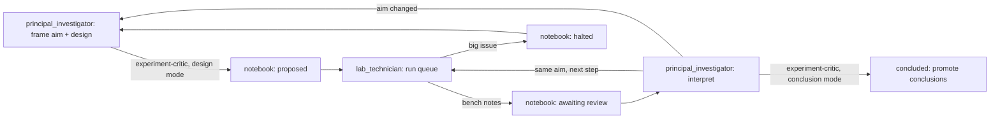

# experiments

The project's experiment record. Each experiment has one directory and
one notebook (`NOTEBOOK.md`), organised around one aim: a hypothesis, a
problem, or both.

- **Rules:** `EXPERIMENT_PRINCIPLES.md`.
- **Workflow:** the `principal_investigator` and `lab_technician` skills.
- **Large artifacts:** checkpoints, full logs and the like live in the
  ignored `data/runs/<experiment>/` and are referenced from the
  notebooks.
- **Future work:** [`TODO.md`](TODO.md) lists runs, ablations and
  ideas not yet started.

## Workflow

Short runs (minutes) are run inline during a `principal_investigator`
session, without `lab_technician`.

## Index

| experiment | dates | aim (one line) | status | verdict | parent |
|---|---|---|---|---|---|
| [2026-09-30_first_train_shakeout](2026-09-30_first_train_shakeout/NOTEBOOK.md) | 09-30 | Problem: train and evaluate a single-card model end to end on GPU | concluded | met; deck-contrastive training alone collapses the embedding (effective rank 48 -> 10) and squeezes out rarity | - |
| [2026-10-09_model_by_diet](2026-10-09_model_by_diet/NOTEBOOK.md) | 10-09 - 10-10 | Problem: which model × diet trains the best embedding? | halted | not answered: only `multi_mixed` ran, and an unbounded shared embedding vector destabilized it | first_train_shakeout |
| [2026-10-10_lr_pilot](2026-10-10_lr_pilot/NOTEBOOK.md) | 10-10 | Problem + hypothesis: unstable metric losses; the output LayerNorm alone fixes them | concluded | problem met; hypothesis supported (one seed); `encoder_lr` 1e-4 adopted; contrastive still at chance | model_by_diet |
| [2026-10-10_pooling_probe](2026-10-10_pooling_probe/NOTEBOOK.md) | 10-10 | Problem: how much deck signal can cosine see in frozen features, and with which choices? | concluded | fixed-feature ceiling ~0.65 deck AUC via whitening (control 0.54); centering alone barely helps | lr_pilot |
| [2026-10-10_pooling_pilot](2026-10-10_pooling_pilot/NOTEBOOK.md) | 10-10 - 10-11 | Problem + hypothesis: contrastive at chance; the shared offset causes it; whitening and/or trainable pooling fixes it | halted | problem largely met by whitening (0.81-0.86); offset as the cause not established; trainable pooling adds little; 2 of 8 variants open | pooling_probe |

### Migrated experiments

The five experiments above predate this layout. Each notebook opens
with a migration note saying what was reconstructed and what is
missing under today's rules.

Their raw data is in the ignored `data/runs/`, and the notebooks give the
paths:
- runs under `data/runs/Oct_*`;
- console logs and diagnostics, which first lived in `logs/`, in a
  `legacy_logs/` folder: inside the experiment's `data/runs/Oct_*`
  folder, or under `data/runs/<experiment>/` for an experiment without
  one.

Their configs are the ones each run recorded. Configs that never ran
are still launch configs, whose comments give the old
`configs/training/...` paths.

## Typical environment

These are approximate figures for planning and for `lab_technician`'s
checks. They change with the model, data and code. Update them from
measured run times.

- **Machine:**
  - AMD Ryzen 7 3700X (8 cores, 16 threads);
  - 32 GB RAM, about 22 GB free at idle with the usual desktop apps;
  - AMD RX 6800 with 16 GB VRAM;
  - training uses the ROCm venv `G:\Projects\venvs\tcg-rocm` (torch
    2.10, ROCm 7.13).
- **Disk:** the project and `data/` are on G:, which had about 1.1 TB
  free on 2026-10-11.
- **Memory protection:** Claude Code stops a background job when system
  memory runs low, and this stays on. An experiment that keeps tripping
  it needs a design change.
- **Time per run** (multi-card model, frozen ModernBERT):
  - **reduced mixed diet** (45 trained dojos), measured 2026-10-10:
    about 24 min per 1,000 steps including TEST, so about 71 min for
    3 × 1,000. The transformer pooling variant took about 84 min. Allow
    about 2 min between queued runs.
  - **full mixed diet** (149 trained dojos), measured 2026-10-10: about
    37 min per round, of which about 14 min is TEST. Startup
    (calibration and preflight) takes about 28 min.

  At the reduced-diet figure, the ~24 h gate allows about 20 runs.
- **Disk per run:** about 2.4 GB. Checkpoints include the frozen
  ModernBERT.
- **Pre-flight thresholds (provisional, to be replaced by measured
  peaks):**
  - at least 12 GB free RAM;
  - at least 14 GB free VRAM;
  - at least 100 GB free on G:.

  The full-mixed run used about 7.5 GiB RAM and about 4.4 GiB VRAM.
