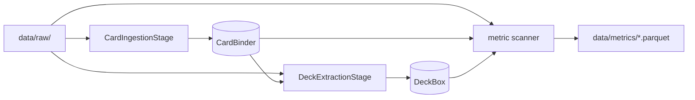
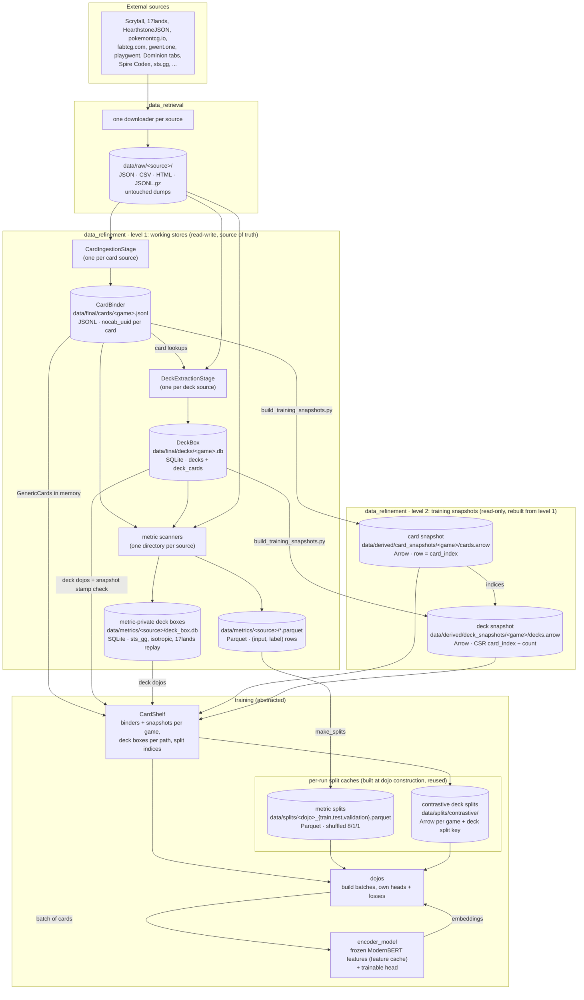

# data_refinement

Turns raw data written by `data_retrieval` (`data/raw/`) into this
project's own schema (`src/schema/`) and training labels. Everything it
writes lands under `data/final/` (cards, decks), `data/metrics/`
(labels) or `data/derived/` (training snapshots).

[`CURRENT_STATUS.md`](CURRENT_STATUS.md) tracks which retrieval
sources have binder, deck box and metric coverage, and what to build
next.

## Containers

- **[`card_binder/`](card_binder/README.md)** - `CardBinder`, the
  multi-game card store that gives every card its stable `nocab_uuid`,
  plus one `CardIngestionStage` per card source. Every other flow
  depends on it. Output: `data/final/cards/<game>.jsonl`.
- **[`deck_box/`](deck_box/README.md)** - `DeckBox`, the multi-game deck
  store (SQLite, CRUD by `nocab_uuid`), plus one `DeckExtractionStage`
  per deck source. Output: `data/final/decks/<game>.db`.
- **[`metrics/`](metrics/README.md)** - one directory per raw source,
  each turning that source into (training input, label) parquet files
  a dojo reads. Output: `data/metrics/<source>/`.
- **[`snapshots/`](snapshots/README.md)** - level 2: read-only Arrow
  card and deck snapshots compiled from the binder and deck boxes,
  stamped with the versions they came from, for fast training reads.
  Output: `data/derived/{card,deck}_snapshots/<game>/`.
- **[`seventeenlands/`](seventeenlands/README.md)** - the 17lands CSV
  chunk parser and deck identity, shared by `deck_box`'s 17lands
  extraction stage and the 17lands metrics, so both store and reference
  the same decks. Imports neither.

[`deck_ids.py`](deck_ids.py) is the one file living directly here
rather than in a container above: `deck_uuid_from_cards()`, the
content-addressed deck-id hashing both `deck_box` (a source's
extraction stage) and `metrics` (that same source's metrics) need to
agree on, so a deck gets the same id on both sides. Kept a sibling of
both rather than inside either, so neither depends on the other just
to reach it.

## How it works



Card ingestion runs first: deck extraction and metrics both look cards
up in the binder, so a game's binder must exist before either runs.

## Project data flow

The whole path from external source to training, with the file format
at each stop. Data refinement has two levels:

- **Level 1, the working stores:** the card binder (JSONL), the deck
  boxes (SQLite) and metric parquets. Ingestion writes them with
  create/update, deduplication and aliases; they are the single source
  of truth.
- **Level 2, the training snapshots:** read-only Arrow files compiled
  from level 1, stamped with the versions they came from, and rebuilt
  when those change. Training reads them as arrays.

Training is drawn as one box; its own READMEs cover the inside.



Metric splits and contrastive deck splits are per-run caches the dojos
build at construction (they depend on the run's holdout), not level 2.

## How to run

```
PYTHONPATH=. python3 scripts/run_card_binder_ingestion.py --source scryfall
PYTHONPATH=. python3 scripts/run_deck_box_ingestion.py --source play_gwent
PYTHONPATH=. python3 scripts/run_metrics.py --source gwent_one
PYTHONPATH=. python3 scripts/build_training_snapshots.py --game gwent
```

The first three take `--list`, `--source <name>` or `--all`;
`build_training_snapshots.py` takes `--game <game>` or `--all`, and runs
after the binder and deck box it compiles.
