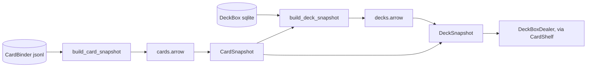

# snapshots

Level-2 data refinement: read-only Arrow files compiled from the level-1
stores (`../card_binder/`, `../deck_box/`) in the shape training reads
fastest. A snapshot is never edited. It is stamped with the level-1
versions it was built from, and rebuilt by
`scripts/build_training_snapshots.py` when those change. Training only
reads snapshots: a missing or stale one raises `StaleSnapshotError`
naming that script.

Two files per game, under `data/derived/` (not in git):

- **Card snapshot**, `card_snapshots/<game>/cards.arrow`: one row per card
  of the game, plus the game's Unknown sentinel (added if the binder lacks
  it), ordered by `nocab_uuid` bytes. Columns: `nocab_uuid
  fixed_size_binary(16)` and `is_unknown bool`.
- **Deck snapshot**, `deck_snapshots/<game>/decks.arrow`: one row per deck
  of the game's published deck box (`data/final/decks/<game>.db`),
  ordered by deck `nocab_uuid` bytes. Columns: `nocab_uuid
  fixed_size_binary(16)` and `cards list<struct<card_index: uint16,
  count: uint8>>`, with one entry per distinct card, ascending by
  index. A deck's name and provenance are not kept.

## Card ids

There are two ids:
- `nocab_uuid` is a card's permanent identity, shared by the binder, the
  deck boxes and the metrics.
- `card_index` is a row of one card snapshot. It is valid only together
  with that snapshot's stamp, and the card snapshot is the only
  translation between the two ids. The deck snapshot stores indices, and
  its stamp embeds the stamp of the card snapshot those indices point
  into.

The card snapshot is stored rather than recomputed at startup so that a
code change in card ordering can never silently repoint every deck.

## Limits

- `uint16` indices cap a game at 65,536 card rows; the builder raises
  past that. MTG has about 35k.
- `uint8` counts cap a deck entry at 255. Larger counts are clipped
  (StS2 has runs of about 1k cards), and the builder logs one warning
  per build. The deck box keeps the true count.
- A deck card missing from the card snapshot maps to the sentinel's index
  and is logged.
- The deck box's version is a hash of its binder stamp and deck count
  (`DeckBox.version_for`). A change that keeps the count is invisible,
  so the snapshot is not rebuilt; `--force` rebuilds anyway. This risk is
  accepted.

## Files

- `stamps.py`: `CardSnapshotStamp` and `DeckSnapshotStamp` (round-tripped
  through Arrow schema metadata), `StaleSnapshotError`,
  `StaleDeckBoxError`, `SNAPSHOT_ROOT`.
- `columns.py`: the column names and types both snapshots share.
- `arrow_files.py`: atomic single-batch Arrow IPC writes, memory-mapped
  reads, and fixed-width byte views. Its errors are neutral. It is also
  used by `DeckSplitIndex` (`../../dojos/file_managers/`).
- `card_snapshot.py`: `CardSnapshot`, the reader. It checks the stamp
  against the live binder and builds `card_uuids` (index -> `UUID`)
  once.
- `deck_snapshot.py`: `DeckSnapshot`, the reader. It checks the stamp
  against the live deck box and the open card snapshot, and exposes the
  columns as read-only NumPy views: `deck_uuid_bytes`, `deck_offsets`
  (int32 CSR offsets), `card_indices` and `card_counts`.
- `build.py`: `build_card_snapshot` and `build_deck_snapshot`. The deck
  build streams `DeckLookup.deck_card_counts` once, in the box's storage
  order: one sequential pass over `deck_cards`, since reading 40 GB in
  uuid order is one random seek per deck. It then sorts the decks by
  uuid in memory. It refuses a deck box minted against another binder
  (`StaleDeckBoxError`) and a deck read twice (`ValueError`).

## How it works



Files are uncompressed Arrow IPC holding exactly one record batch, so
each column is one contiguous buffer that NumPy wraps without copying.
Each file is written under a temporary name and renamed into place.
Readers memory-map the file, so the OS pages it in as it is read. Read
the arrays, never per-element pyarrow scalars. A rebuild may replace a
file a running process has mapped; that process keeps reading the old
contents until it reopens.

`CardShelf` (`../../training/dojo_recipes/card_shelf.py`) opens each
game's snapshots once per process. Building a contrastive dojo checks
both levels before preflight: the deck box exists, and its snapshots
exist and match it. Checking the deck box version counts its decks,
which takes about 48 s cold on MTG.

## How to run

```
PYTHONPATH=. python3 scripts/build_training_snapshots.py --game mtg
PYTHONPATH=. python3 scripts/build_training_snapshots.py --all
PYTHONPATH=. python3 scripts/build_training_snapshots.py --game mtg --force
```

Run the script after card binder and deck box ingestion. A snapshot
that is already current is skipped unless `--force` is given. A game
with no published deck box gets only a card snapshot.
