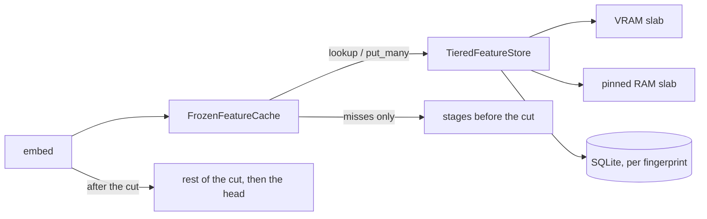

# feature_cache

This package caches what a card pipeline's frozen stages output for
each card text, at one of two cuts (a `CutPoint`):

- **pooled**: after the text encoder, optional token whitening and mean
  pooling; one vector per text. Only the head runs live.
- **tokens**: the text encoder's token states, one row per real token
  (`RaggedTokenStates`): its whole output, or the states after layer k
  of a `LayeredTextEncoder`. The encoder's layers above k, the
  enrichment and the pooling run live, and may train (attention
  pooling, the top layers of ModernBERT).

The frozen stages then run once per distinct text instead of on every
training step.

The cache is optional: `CardEmbeddingPipeline(..., feature_cache=None)`
runs every stage on every call. Rows can live in three tiers, VRAM,
pinned RAM and an SQLite file on disk, and the disk tier lets runs and
experiments share their encodes.

The key is the serialized text, never the card's `nocab_uuid`. A mod
keeps the uuid and changes the text, so a modded card is just another
key.

## Files

- `card_text_key.py`: `CardTextKey.of_text(text)`, a 16-byte BLAKE2b
  digest of the text `serialize_card_to_json` produces.
- `feature_storage_dtype.py`: `FeatureStorageDtype` (`fp32` / `fp16` /
  `bf16`), the dtype rows are stored in. It has `.torch_dtype` and
  `.rows_in(capacity_mib, width)`, which turns a MiB budget into rows
  for every tier. It sets storage rounding only, not the autocast
  compute precision.
- `frozen_stage_fingerprint.py`: `FrozenStageFingerprint`, everything
  that fixes a cached row's numbers for a given text:
  - the text encoder's `TextEncoderSource` (checkpoint, Hugging Face
    commit hash, `max_length`, `model_kwargs`);
  - the whitening stats file's sha256;
  - the pooling label;
  - the compute precision;
  - the width;
  - the storage dtype;
  - the cut (only written into the digest for a token cut, whose
    enrichment and pooling are "none": its rows come before them).

  `digest()` names a row set on disk.
- `cut_point.py`: `CutPoint`, a union of `PooledCutPoint` and
  `TokenCutPoint(layer)` (`layer` None: the encoder's whole output).
  The one source of truth for the cut: the fingerprint holds it, and
  the stores' row kind (`cut.row_kind`) and the pipeline's
  `PipelineCut` are derived from it.
- `ragged_token_states.py`: `RaggedTokenStates(values (T, W), lengths
  (N,) int64 CPU)`, token states packed without padding:
  `from_encoding`, `to_encoding`, `select`, `to`, `concatenate`.
- `feature_row_kind.py`: `FeatureRowKind[F]` (Strategy), what the stores
  need to know about a feature type: `row_counts`, `flat_rows`,
  `from_flat_rows`, `select`, `concatenate`, `to` (which detaches).
  `POOLED_ROWS` (Tensor, a row per text) and `TOKEN_ROWS`
  (RaggedTokenStates, a row per token). Also `require_offer_shape`, the
  check every `put_many` makes first.
- `feature_store.py`: `FeatureStore[F]` (Protocol): batched,
  thread-safe `lookup(keys, device) -> StoreLookup` and
  `put_many(keys, features, durable) -> admitted`, `pin(keys)` /
  `unpin(keys)`, plus `tier_stats()`, `storage_dtype`, `row_kind` and
  `close()`. Also `TierStats` (hits, fill, `pinned_rows`,
  `refused_for_pins`). Fill and capacity count rows of the row kind.
- `slot_policy.py`: `SlotPolicy` (Strategy), which decides which offered
  keys a memory tier admits and which held keys it evicts, given the
  tier's pinned keys: `admit(offered, free_rows, pinned, *,
  row_counts=None) -> AdmissionDecision`, where `row_counts` is each
  offered key's rows (None: one each). The evicting policies record
  each held key's rows and evict until the admitted rows fit. None
  evicts a pinned key.
  - `FillUntilFull` admits while rows are free and never evicts.
  - `FirstInFirstOut`, `LeastRecentlyUsed` (the default) and
    `LeastFrequentlyUsed` (fewest hits, oldest first among ties) share
    a Template Method base that admits the first `capacity_rows` offered
    keys and evicts each one's victims. `LeastRecentlyUsed` is
    `FirstInFirstOut` plus "a hit moves the key to the newest end".
  - `SecondOfferAdmission(inner, remembered_keys)` is a Decorator over
    any of them: a key reaches `inner` only on its second offer. First
    offers are remembered in a bounded FIFO set; a repeat that `inner`
    refuses stays remembered. Under prefetch a card's reservation is its
    first offer, so its step encodes it again.
- `tensor_feature_slab.py`: `TensorFeatureSlab(name, capacity_rows,
  storage_dtype, policy, placement, row_kind)`, a memory tier. Its rows
  sit in one preallocated tensor, with a CPU dict from key to its rows
  (an int64 array: one row pooled, one per token). A key's rows need not
  be adjacent: freed rows go on a stack, so token rows never fragment. `SlabPlacement`
  is `FOLLOW_FIRST_PUT` (the first put's device, VRAM in training) or
  `PINNED_HOST` (the RAM tier).
- `sqlite_feature_store.py`: `SqliteFeatureStore(path, fingerprint,
  capacity_rows)`, the disk tier. One file holds any number of row sets,
  one per fingerprint digest; its row kind follows the fingerprint's
  cut. One blob per key (a token cut's blob holds its tokens' rows, so
  the row count is the blob's size over width x itemsize). It keeps
  only durable puts and admits until its row set's rows are full.
- `tiered_feature_store.py`: `TieredFeatureStore(tiers)`, the chain,
  fastest tier first; every tier must hold the same row kind.
- `frozen_feature_cache.py`: `FrozenFeatureCache[F](store, fingerprint,
  durable_misses)`, the component the pipeline calls, with
  `features`, `reserve` and `release`; it refuses a store whose row
  kind is not the fingerprint's cut's. Also `FeatureReservation` and
  `FeatureCacheStats`.

## How it works

`CardEmbeddingPipeline.embed(cards)` serializes the cards, then calls
`cache.features(texts, cut.encode_before_cut, device)`, where `cut` is
the pipeline's `PipelineCut` for the cache's cut point
(`../pipeline_cut.py`), and finishes with `cut.pool_after_cut` and the
head. Every step below goes through the store's row kind, so it is the
same for both cuts:

1. Check that the active autocast is the fingerprint's compute
   precision.
2. Fold duplicate texts, and key each distinct text once.
3. `store.lookup(keys, device)`: the chain asks each tier in turn about
   the keys the tiers above missed, and offers each lower-tier hit to
   the tiers above it (promotion).
4. Run `encode_before_cut` once, under `no_grad`, on the misses only. Round the
   result to the storage dtype and offer it to every tier
   (write-through), so each tier's policy decides what to keep.
5. Return float32 rows on `device`, in the texts' order.

A miss is rounded exactly as a stored row is, so a card's features never
depend on whether it hit or which tier answered. The head always
receives float32, as on the live path.



### Reservations

A prefetch worker reserves a batch before its step runs:
`model.reserve(cards, precision) -> FeatureReservation` (through the
pipeline to `cache.reserve(texts, ...)`).

1. Check the precision, then pin the batch's distinct keys in every
   memory tier.
2. Look up and encode as `features` does, without returning rows.
3. If that raises, unpin and re-raise.

`release(reservation)` unpins once the step has looked its features up.

- **Pins are reference counts.** One key can sit in several queued
  batches. A key can be pinned before it is held.
- **No pinned row is evicted.** A slab passes its pinned keys to its
  policy. The slab raises `RuntimeError` if a decision evicts one.
  When pinned rows fill a slab, the rest of an offer passes through
  unstored and counts in `refused_for_pins`.
- **The disk tier ignores pins**, since it never evicts.
- **Reservations are compared by identity.** The cache keeps the ones
  not yet released. Releasing one twice, or another cache's, raises
  `ValueError`. An empty reservation (no texts, or a pipeline without a
  cache) releases freely.
- **Totals.** A reservation's encodes count in `encoded`, but its texts
  are not counted in `texts`. The step's own `features` call counts
  them, so `avoided_fraction` still describes training lookups.

Releasing right after the step's lookup is safe because of the slab's
stream rule below. The lookup gathers into its own tensor on the
default stream, and any later overwrite is queued after it.

Invariants:

- **Inclusive tiers.** Every put is offered to every tier, so an eviction
  from an upper tier needs no copy downward: the row is usually already
  below.
- **Durable means disk.** The disk tier stores only puts made with
  `durable=True`. `warm()` always puts durably. A training miss is
  durable only with `disk.write: all`, since the disk never evicts.
- **Stamped texts are never stored.** `features` and `reserve` take
  `cacheable` flags parallel to the texts (the pipeline passes
  `GenericCard.cacheable`; a random mod's cards are stamped False). A
  distinct text is cacheable if any of its positions is. An uncacheable
  text is still looked up, since a random mask can land on a stored
  text, and on a miss it is encoded but never offered to any tier, and
  counted in `FeatureCacheStats.uncacheable`. `reserve` skips it
  entirely, so its encode runs in the step.
- **Frozen stages only, always in eval mode.** The pipeline refuses a
  cache when a stage before its cut has a parameter with
  `requires_grad` (`PipelineCut.check_frozen`). With a cache, `train()`
  keeps those stages in eval. `ModelSpec` refuses a pooled cut with
  attention or transformer pooling, and trainable text layers unless
  the cut is inside the encoder below them.
- **One compute precision.** `features()` raises `ValueError` when the
  active autocast is not the fingerprint's precision.
- **A pinned source for the disk.** `SqliteFeatureStore` refuses a
  fingerprint whose text encoder has no source or no revision (a local
  path), because its weights could change under the same name.
- **Not in the checkpoint.** The cache is a plain attribute of the
  pipeline, so `state_dict()` is the same with or without it.
- **Thread-safe.** Each store takes a lock around `lookup` and
  `put_many`. On CUDA, every slab gather and write runs on the device's
  default stream, synced with the caller's stream in both directions.
  Hits handed to another stream get `record_stream`. Pinned rows are
  written with blocking copies. No lock is held while encoding. Pins
  rely on this ordering, so a change to the slab's streams must keep
  it.
- **Lifecycle.** The SQLite connection opens on first use (WAL,
  `synchronous=NORMAL`, a 30 s busy timeout), so building a model creates
  no file. `close()` closes it, and a closed store refuses further use.

A token row set is far larger than a pooled one: about 35-300 rows per
card instead of one, so the same MiB budget holds that many times fewer
cards, and VRAM usually holds only a hot subset.

The disk file runs about 3x its row payload at pooled widths. Each row
carries its 64-character digest and its key, and a 4 KiB page holds only
about two 1.5 KB rows.

## How to run

```python
from src.training.feature_cache_assembly import assemble_feature_cache, build_fingerprint

fingerprint = build_fingerprint(encoder.source(), None, "mean", "fp16", 768,
                                spec.feature_cache.storage_dtype)
cache = assemble_feature_cache(spec.feature_cache, fingerprint)
pipeline = CardEmbeddingPipeline(encoder, None, MeanPooling(768), head, cache)
model = SingleCardModel(pipeline).to("cuda")
model.warm(cards, "fp16")            # optional
reservation = model.reserve(batch_cards, "fp16")   # pinned until released
model.release(reservation)
model.feature_cache_stats()          # FeatureCacheStats(texts, encoded, admitted, tiers, uncacheable)
model.close_feature_cache()
```

A token cut after ModernBERT's layer 20, training its top 2 layers and
an attention pooling:

```python
from src.encoder_model.feature_cache.cut_point import TokenCutPoint
from src.encoder_model.modernbert_text_encoder import load_text_encoder

encoder = load_text_encoder("answerdotai/ModernBERT-base", trainable_top_layers=2)
fingerprint = build_fingerprint(encoder.source(), None, "attention", "fp16", 768,
                                FeatureStorageDtype.FP16, TokenCutPoint(20))
cache = assemble_feature_cache(spec.feature_cache, fingerprint)
pipeline = CardEmbeddingPipeline(encoder, None, AttentionPooling(768), head, cache)
```

In a run config: `model: {trainable_text_layers: 2, pooling: {kind:
attention}, feature_cache: {cut: tokens, cut_layer: 20, storage_dtype:
fp16, vram: {capacity_mib: 4096}, ram: {...}, disk: {...}}}`.

From a run config, see `model.feature_cache` and `warm_feature_cache` in
`../../training/README.md`. `scripts/warm_feature_cache.py <config>`
fills the disk tier without training.
