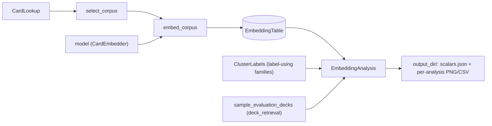

# evaluation/intrinsic

Intrinsic evaluation fits no model: it embeds cards once into a table,
then analyzes the stored vectors. One table holds one encoder's
embeddings; comparing encoders means comparing tables built from the same
corpus.

## Files

Grouped by evaluation family; each business-logic class has its own file,
sharing it only with small data classes or trivial helpers. The files
directly here are shared by more than one family (or, like
`effective_rank.py`, are a family of one file).

- [card_row.py](card_row.py): `CardRow` (`nocab_uuid`, `source_game`),
  the key the embedding table, labels and analyses all share.
- [embedding_analysis.py](embedding_analysis.py): the `EmbeddingAnalysis`
  Protocol (`name`, `run(table, output_dir) -> AnalysisResult`) and the
  shared output contract: `require_fresh_output_dir` (a non-empty
  directory is an earlier run's results: `FileExistsError`) and
  `write_analysis_result` (writes `scalars.json`; NaN/inf is refused,
  never written).
- [unit_length.py](unit_length.py): `scale_to_unit_length`, the cosine
  preparation the analyses share (a zero vector stays zero).
- [effective_rank.py](effective_rank.py): `EffectiveRank`, label-free and
  unsampled: exp(entropy) of the centered vectors' variance shares, i.e.
  how many directions the embedding really uses (`effective_rank`,
  `effective_rank_fraction`, `top1_variance_share`,
  `top5_variance_share`). Flags dimensional collapse.

- [embedding/](embedding/): cards to stored vectors.
  - [select_corpus.py](embedding/select_corpus.py): `CorpusSpec` (games,
    optional `TierFilter`) and `select_corpus(cards, spec)`, a lazy
    generator over the chosen games' cards, in `GameId` order. A
    `TierFilter` keeps an exact set of holdout tiers under a given
    `HoldoutSpec` (e.g. only VALIDATION cards, the ones a checkpoint never
    saw): domain shift is expressed by which cards go in, not by a
    separate evaluation mode.
  - [embedding_table.py](embedding/embedding_table.py): `EmbeddingTable`,
    one encoder's card embeddings in a SQLite file, keyed by `nocab_uuid`.
    Its games are fixed at `create()`. `rows()` is sorted by
    `nocab_uuid`, so seeded sampling picks the same cards from any two
    tables over the same corpus. Every `add()` is committed before it
    returns, and a stored table is always finite
    (`require_finite_vectors`, `NonFiniteEmbeddingError`).
  - [embedding_table_metadata.py](embedding/embedding_table_metadata.py):
    `EmbeddingTableMetadata`, what produced a table (encoder label,
    checkpoint, width, binder version per game, time), with its lossless
    `to_json()` / `from_json()`.
  - [embed_corpus.py](embedding/embed_corpus.py): `embed_corpus`, which
    embeds a corpus into a table in batches, and the `CardEmbedder`
    Protocol it takes (`embedding_dim`, `isolated_embeddings`), which
    `SingleCardModel` and `MultiCardModel` satisfy as they are.

- [cluster_labels/](cluster_labels/): the cluster label each card should
  carry under one grouping (its game, rarity, faction, ...): known facts
  about cards, never clusters an analysis found. The input of the
  label-using families, which color by them and score the embedding's
  clusters against them.
  - [cluster_labels.py](cluster_labels/cluster_labels.py): the
    `ClusterLabels` Protocol (`grouping`, e.g. `"rarity"`, used in output
    paths and legends; `cluster_label_of(row) -> str | None`, e.g.
    `"rare"`, `None` meaning the card has none under this grouping),
    `GameClusterLabels`, and `HoldoutTierClusterLabels` (a card's tier
    under a `HoldoutSpec`, typically the checkpoint's own: the
    domain-shift grouping).
  - [metric_parquet_cluster_labels.py](cluster_labels/metric_parquet_cluster_labels.py):
    `MetricParquetClusterLabels(grouping, parquet_paths)`, from one or
    more per-card categorical metric parquets (only `nocab_uuid` and
    `label` are read, with pyarrow so integer labels stay integers); a
    card in more than one row is rejected, a null label leaves it
    unlabeled.

- [label_agreement/](label_agreement/): does the geometry agree with known
  categories?
  - [card_sample.py](label_agreement/card_sample.py): the seeded
    `CardSample` rules, `AllCards` and `PerLabelCap(n)` (at most n cards
    per label, so one dominant label cannot swamp the rest). The same
    table + labels + seed always picks the same cards.
  - [labeled_sample.py](label_agreement/labeled_sample.py):
    `draw_labeled_sample`, the preparation every label-using analysis
    shares (sample, drop unlabeled cards, require two cards and two
    labels, read vectors).
  - [cluster_agreement.py](label_agreement/cluster_agreement.py):
    `ClusterAgreement`, KMeans (k = number of labels) blind to the labels,
    scored against them: `ari`, `nmi`.
  - [label_compactness.py](label_agreement/label_compactness.py):
    `LabelCompactness`: `silhouette`, and `nearest_centroid_accuracy`
    with leave-one-out centroids (a card never votes for itself) next to
    its `majority_baseline`. Needs some label with two or more cards.

- [projection/](projection/): an illustrative t-SNE picture; report it
  next to a numeric analysis. Samples through `label_agreement/`'s
  `draw_labeled_sample`.
  - [projection_plot.py](projection/projection_plot.py): `ProjectionPlot`,
    a seeded t-SNE of the sampled cards. Writes `projection.png` (up to
    the style's `max_highlighted` labels colored, the rest folded into a
    neutral "Other"), `projection_by_label.png` (small multiples: one
    panel per label, the `max_panels` largest - 12 by default),
    `projection.csv` (`nocab_uuid`, `source_game`, `label`, `x`, `y`: the
    table view, and re-plotting without re-running t-SNE) and
    `scalars.json` (`kl_divergence`, left out if not finite).
    `highlighted` takes a count (most-sampled first, ties by name) or the
    labels themselves - name them when comparing encoders under
    `PerLabelCap`, where every large label ties.
  - [projection_renderer.py](projection/projection_renderer.py):
    `ProjectionRenderer` draws both figures in a `FigureStyle` (a frozen
    dataclass; defaults are the dataviz reference palette, light mode).
    The overview's color limit is the style's `max_highlighted`
    (`len(series)`): only three colors stay distinguishable in a scatter
    for color-blind readers, so a custom `series` must be re-validated.

  The three label-using analyses work on unit-length vectors, so distances
  rank pairs like cosine distance, and all report `n_cards` and `n_labels`
  (`LabeledSample.size_scalars`) - a convention for label-using analyses,
  not something the Protocol enforces.

- [deck_retrieval/](deck_retrieval/): same-deck retrieval AUC, label-free.
  - [evaluation_decks.py](deck_retrieval/evaluation_decks.py):
    `EvaluationDeck` (`deck_uuid`, `source_game`, `card_uuids`: distinct,
    in deck order, the game's Unknown placeholder removed),
    `EvaluationDeckSpec` (`count` per game, `seed`, `min_cards`, default
    4) and `sample_evaluation_decks(deck_lookup, game, holdout, spec)`: up
    to `count` of the game's VALIDATION decks under the holdout's deck
    split (`HoldoutSpec.deck_split_of`), ordered by sha256 of (seed, deck
    uuid), so the same box, holdout and spec give the same decks on any
    machine and after a box rebuild. Kept apart from the table the way
    labels are (an `EmbeddingTable` holds cards only). Card tiers are not
    filtered (the VALIDATION view sees every tier). A holdout with no deck
    split (`deck_split_ratios` is None) raises `UnknownDeckSplitError`:
    its VALIDATION decks cannot be known.
  - [deck_retrieval_auc.py](deck_retrieval/deck_retrieval_auc.py):
    `DeckRetrievalAuc(decks, holdout, config, seed)` and `DeckAucConfig`
    (`bootstrap_draws`, default 1000; `max_negatives_per_game`, default
    every card). The contrastive dojos' task measured on a frozen encoder,
    which `run_extrinsic` cannot do (contrastive dojos have no trainable
    head). For an anchor card in a deck, its AUC is the probability that a
    deck-mate is closer (cosine) than a same-game card outside the deck,
    ties counted 1/2 (Mann-Whitney); 0.5 is chance. Unweighted means:
    anchors -> deck, decks -> game, games -> `deck_auc`. Negatives are
    every other same-game card in the table except the Unknown placeholder
    (or one seeded sample per game, capped). Scalars: `deck_auc` and
    `deck_auc.<game>`, each with `_lo95`/`_hi95` (a percentile bootstrap
    over decks within each game: it covers which decks were sampled, not
    retraining noise); `deck_auc.train_anchor` / `deck_auc.heldout_anchor`
    (anchors split by holdout tier: a non-TRAIN anchor was never in a
    training example); `n_decks`, `n_anchors`, `n_missing_cards` (deck
    cards not in the table, skipped), `n_dropped_decks` (fewer than two
    cards in the table, or no negative), `n_dropped_games`. Also writes
    `per_deck.csv` (one row per scored deck, with its per-tier AUCs) for
    paired comparison across encoders scored on the same decks.
  - [deck_score.py](deck_retrieval/deck_score.py): `DeckScore` and
    `anchor_aucs`, one deck's scoring.
  - [deck_auc_summary.py](deck_retrieval/deck_auc_summary.py): the scalars
    from every game's deck scores.

## How it works



`embed_corpus` skips every card already in the table, so an interrupted
run resumes where it stopped and a second corpus can extend a table. It is
built for unattended runs: a batch whose embedding fails (an exception, or
NaN/inf output) is logged and skipped, its cards left out for a re-run to
retry, and only `max_consecutive_failures` failed batches in a row stop
the run. A card of a game the table was not created for raises at once.

## How to run

The full driver is described in the [parent README](../README.md). By
hand, embedding a corpus:

```python
from src.evaluation.intrinsic.embedding.embed_corpus import embed_corpus
from src.evaluation.intrinsic.embedding.embedding_table import EmbeddingTable
from src.evaluation.intrinsic.embedding.embedding_table_metadata import (
    EmbeddingTableMetadata,
)
from src.evaluation.intrinsic.embedding.select_corpus import CorpusSpec, select_corpus

games = frozenset({GameId.MTG, GameId.GWENT})
spec = CorpusSpec(games=games, tier_filter=None)
metadata = EmbeddingTableMetadata(
    encoder_label="single_v1", checkpoint_dir=checkpoint_dir,
    embedding_dim=model.embedding_dim,
    binder_versions={game: binder.version_for(game) for game in games},
    created_at=datetime.now(timezone.utc),
)
with EmbeddingTable.create(Path("data/evaluations/run_a/embeddings/single_v1.db"), metadata) as table:
    embed_corpus(model, select_corpus(binder, spec), table, batch_size=64, precision="fp16")
```

Then analyzing it:

```python
from src.evaluation.intrinsic.label_agreement.card_sample import PerLabelCap
from src.evaluation.intrinsic.label_agreement.cluster_agreement import ClusterAgreement
from src.evaluation.intrinsic.label_agreement.label_compactness import LabelCompactness
from src.evaluation.intrinsic.cluster_labels.cluster_labels import GameClusterLabels
from src.evaluation.intrinsic.projection.projection_plot import ProjectionPlot

cluster_labels = GameClusterLabels()
with EmbeddingTable.open(Path("data/evaluations/run_a/embeddings/single_v1.db")) as table:
    for analysis in (ClusterAgreement(cluster_labels, PerLabelCap(500), seed=0),
                     LabelCompactness(cluster_labels, PerLabelCap(500), seed=0),
                     ProjectionPlot(cluster_labels, PerLabelCap(500), seed=0,
                                    highlighted=("mtg", "gwent"))):
        out = Path("data/evaluations/run_a/intrinsic/single_v1") / analysis.name
        print(analysis.name, dict(analysis.run(table, out).scalars))
```
