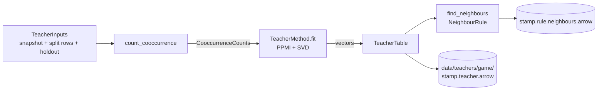

# teacher

Per-game teacher vectors from deck co-occurrence: one vector per card,
built from which cards share decks, with no card text and no model.
The student (the shared text encoder) trains to match them. Built once
per (deck snapshot, holdout, settings) and cached under
`data/teachers/<game>/`.

> TODO (placement): this container is an odd one out in the map. It is
> deck-derived like a metric, per-holdout like a dojo cache, and only
> training consumes it. Revisit where it belongs once the student side
> exists. If teachers become trained models (item2vec, LightGCN, a
> student-refined teacher), it would import `encoder_model` and the
> question becomes pressing.

Imports only `schema` and `data_refinement.snapshots`; never the dojos
or training. The caller turns a `DeckSplitIndex` into plain row arrays
(`src/training/teacher_assembly.py` does this).

## Files

- [teacher_settings.py](teacher_settings.py): `TeacherSettings` (what
  the run config's `teacher:` section parses into), `CopyCountRule`,
  `DeckSizeRule`, `CooccurrenceOptions`, `PpmiSvdOptions`, and
  `fit_digest()` (everything a fitted table depends on).
- [neighbour_rules.py](neighbour_rules.py): the `NeighbourRule`
  Strategy: `TopKNeighbours`, `CosineThresholdNeighbours`.
- [teacher_inputs.py](teacher_inputs.py): `TeacherInputs`, one game's
  deck snapshot with its split rows and holdout, checked to belong
  together.
- [cooccurrence.py](cooccurrence.py): `count_cooccurrence` ->
  `CooccurrenceCounts`, the weighted card x card matrix.
- [teacher_method.py](teacher_method.py): the `TeacherMethod` Strategy
  and `teacher_method_for(options)`.
- [ppmi_svd.py](ppmi_svd.py): `PpmiSvdMethod`, the one method so far.
- [teacher_table.py](teacher_table.py): `TeacherTable` (the vectors,
  saved as Arrow) and `TeacherStamp`.
- [teacher_neighbours.py](teacher_neighbours.py): `TeacherNeighbours`
  (ragged, CSR) and `find_neighbours`.
- [teacher_cache.py](teacher_cache.py): `Teacher` (table plus
  neighbours) and `load_or_build_teacher`, the entry point.

## How it works



1. **Select.** Decks in `deck_splits`, cards in `card_tiers` (both
   `[train]` by default in `TeacherSettings`). A card outside the tiers is dropped from every
   deck before counting. The card snapshot's unknown sentinel is always
   dropped.
2. **Count.** The deck x card incidence X comes from the snapshot's CSR
   arrays, in chunks of 200k decks. Entries are weighted by the
   copy-count rule (`presence` 1, `copies`, `log_copies` 1 + ln copies)
   and rows by the deck-size rule (`uniform`, or `inverse_size`: a deck's
   card pairs share one unit). The result is C = X^T X with the diagonal
   dropped. Deck counts come from presence alone, so weighting never
   moves them.
3. **Fit.** PPMI over C's nonzero pairs, with the context distribution
   smoothed by `context_smoothing`, then a seeded randomized SVD. The
   vectors are U * sqrt(S), width `min(dim, cards - 1)`. Rows in fewer
   than `min_deck_count` decks are kept but flagged not confident.
4. **Neighbours.** Cosine over confident rows only, in blocks of 1024
   rows. The rule picks how many ranked candidates to keep (top-K, or
   all above a threshold up to a cap). A row that is not confident has
   no neighbours and is nobody's neighbour.
5. **Cache.** The table file is named by `TeacherStamp.tag()`. The stamp
   holds the deck snapshot stamp, the holdout's `deck_split_key` and
   `card_tier_key()`, and `fit_digest()`. The neighbours file adds the
   rule's tag. A file with another stamp or rule is ignored and rebuilt.

A run builds one teacher per student split (`TeacherViews`, in
`teacher_settings.py`): the views share every setting but `deck_splits`
and `card_tiers`. By default the TRAIN view counts TRAIN decks and keeps
TRAIN cards, and the TEST view counts TRAIN + TEST decks and keeps TRAIN +
TEST cards, so the student is scored on TEST cards it never trained on
(see `src/dojos/file_managers/neighbour_dealer.py`). Each view caches
separately: its scope is in its fit digest.

Teachers are per game: decks never cross games, so each game's space is
its own, arbitrarily oriented against the others. A held-out game has no
TRAIN decks, so it gets no teacher.

## How to run

A training run's config carries the section (see
`src/training/config_parsing/teacher_parsing.py` for every key):

```yaml
teacher:
  games: [mtg, flesh_and_blood]
  method: {kind: ppmi_svd, dim: 128}
  neighbours: {kind: top_k, k: 32}
  views:                    # optional; these are the defaults
    train: {deck_splits: [train], card_tiers: [train]}
    test: {deck_splits: [train, test], card_tiers: [train, test]}
```

A view may only keep card tiers its split can see
(`HoldoutSpec.visible_tiers`); the run config rejects any other.

To build or check the cache ahead of a run:

```bash
PYTHONPATH=. python3 scripts/build_teachers.py --config <run config yaml> [--game mtg]
```

From code:

```python
teachers = teachers_for(GameId.MTG, CardShelf(), config.plan.holdout, config.teacher)
teachers[Split.TRAIN].neighbours.neighbours_of(0)   # teacher rows, most similar first
```
